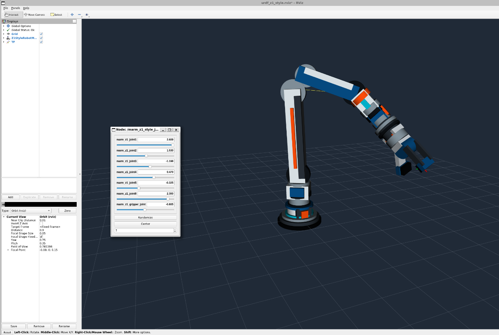

# 机器人建模与平台搭建

用URDF/Xacro描述Z1风格教学模型，通过关节GUI、robot_state_publisher和RViz观察关节方向及TF。模型显示与实体SDK独立启动。

| 文件 | 用途 |
|---|---|
| arm2026_ws/src/CMakeLists.txt | catkin顶层入口 |
| src/marm_description/package.xml、CMakeLists.txt（工作空间内） | 包依赖及构建 |
| urdf/marm_z1_style_core.xacro（包内） | 共享Link、Joint、几何与惯性宏 |
| marm_z1_style.xacro / marm_z1_style_course_variant.xacro（包内urdf） | 主版和课程变体入口 |
| launch/view_marm_z1_style.launch及课程版 | Xacro、GUI、状态发布和RViz |
| urdf_z1_style.rviz | RobotModel和TF显示配置 |

## 实现和参数

两版均为11 Link、10 Joint（7转动、3固定）、57 visual、13 collision。joint4位置(0.19,0,0.05)m，限位±1.51844rad；主版轴(0,1,0)，课程版轴(0,-1,0)。夹爪范围−π/2～0rad，0为闭合。模型含六个机械臂转轴，实体为五姿态轴加夹爪，逐轴对应尚未统一。

## 环境与启动

Ubuntu20.04/ROS1 Noetic、catkin、Xacro、RViz，GUI需Linux桌面或WSLg。从homework根目录：

```bash
source /opt/ros/noetic/setup.bash
sudo apt install ros-noetic-xacro ros-noetic-joint-state-publisher-gui ros-noetic-robot-state-publisher ros-noetic-rviz
cd src/robot_modeling/arm2026_ws
catkin_make -DPYTHON_EXECUTABLE=/usr/bin/python3
source devel/setup.bash
roslaunch marm_description view_marm_z1_style.launch
```

Fixed Frame为marm_z1_base_link，工具坐标系为marm_z1_grasping_frame。GUI发布/joint_states，状态发布器更新TF。停止主版后用 `roslaunch marm_description view_marm_z1_style_course_variant.launch` 比较轴方向。

## 结果与证据

主版零位末端XYZ=(0.182,0,0.180)m。六角度(0.35,0.70,−0.95,−0.45,0.55,0.25)rad时，XYZ约(0.092253,0.157201,0.585738)m，与报告3.3离线数值一致。



该图片从主报告原样提取。模型离线预览、TF图及来源见[实验结果索引](../../results/README.md)。初版报告3.2曾沿用旧X轴模型参数；最新原件已删除该段，旧描述仅存[追溯资料](../../docs/references/legacy_model/README.md)，未混入catkin包。当前Xacro展开和资源引用检查通过；Linux实际构建、GUI需现场验证。

[返回项目](../../README.md) · [项目验证](../../docs/项目验证报告.md)
