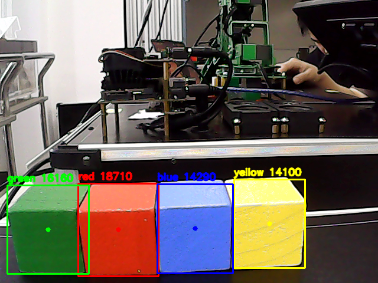

# 视觉识别与自动分拣

在Jetson上识别红、黄、绿、蓝物块，固定从P4抓取并按颜色投桶。像素中心用于标注和记录，当前主版不按像素位置反算任意抓取XYZ。

| 文件 | 用途 |
|---|---|
| [week5.ipynb](week5/5.目标识别/week5.ipynb) | 主HSV识别、取证和严格评分 |
| [week6.ipynb](week6/week6.ipynb) | 固定P4、连续5帧同色确认、抓放和复位 |
| week5/5.目标识别/week5_color_recognition.py | CLI参考类HsvColorRecognizer，参数和评分与主Notebook不同 |
| self_test_week5.py（同目录） | 无相机的CLI合成图测试 |
| test01.ipynb、test02.ipynb（同目录） | 取帧诊断 |

## 方法和参数

BGR转HSV、双红区间inRange、5×5开闭运算、外轮廓面积≥700px²，中心用boundingRect。主识别ROI=None，绿V下限35；红H0～10/170～179，黄18～38，绿40～90，蓝95～135，各S/V阈值保留原值。

分拣ROI=(240,210,440,390)，为左上/右下角，200×180像素。唯一目标连续5帧同色才BUSY，换色或多目标清零。动作后验证P4清空，RESET待空置后READY。P4抓取(200.2,−12.8,45.0,132.7°,179.0°)，上方(198.2,−12.8,75.0,132.7°,179.0°)；运动1.5s、夹爪0.5s。

红→有害、黄→其他、绿→厨余、蓝→可回收。桶位来自Notebook内联bin_map；累计Roll在调用前归一化。旁边CSV是记录，不自动覆盖桶位。

## 环境与运行

Jetson/Linux、Python3、OpenCV、NumPy、ipywidgets/Jupyter；分拣另需共享SDK和pyserial。homework根目录：

```bash
python3 -m pip install -r requirements-jetson.txt
python3 -m jupyterlab
```

主week5加载Cell1/3及Cell9界面，再启动相机、选真值色、保存和记录。主week6加载Cell1/3/5/7及Cell9界面；启动预览会连接并移动机械臂到拍摄位姿。相机默认0，串口默认/dev/ttyTHS1，按现场设备核对。

原硬编码BASE已移除，新输出分别放results/vision_sorting/runtime/week5、runtime/week6。原CSV放data目录，不作为新运行的追加目标。停止预览不具有手势链的完整可取消停止功能。

## 结果与证据

主色28/28正确，唯一目标严格判据22/28。固定红黄绿蓝两轮人工入桶8/8。44条调试日志中35条只是P4清空待确认、8失败、1夹取未成功，不能当作44次成功抓取。



[28次CSV](../../results/vision_sorting/data/week5_test_records.csv) · [8次人工表](../../results/vision_sorting/data/两轮8次分拣记录.csv) · [44条日志](../../results/vision_sorting/data/week6_action_log.csv) · [证据索引](../../results/README.md)

CLI绿色V下限50且评分较宽，不能替代28次统计。6/8帧映射、可取消和多面投票历史版本未混入主程序。乱序、光照鲁棒性和任意位置抓取待独立验收。

[返回项目](../../README.md) · [项目验证](../../docs/项目验证报告.md)
