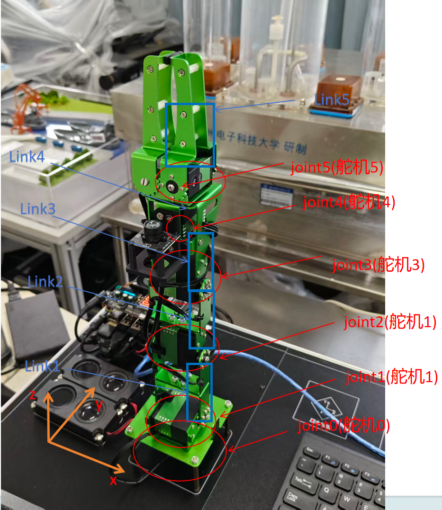

# 图片来源与图题

保留原始字节及宽高比。图中数值只按原图或报告说明解释；流程示意与离线预览单独标记。

## 图1-1 DICE实物结构与基坐标系标注照片

来源 `week1/第11组(1).docx!/word/media/image1.png`，OOXML段落索引109；原报告上下文：请简要标注或绘制机械臂的Base、主要Link/Joint以及基坐标系X、Y、Z轴方向；也可粘贴一张标注后的实物照片。  图1  机械臂Base、主要Link/Joint、末端执行器及基坐标系标注 基坐标系原点 O 位于底座中心附近，X/Y 轴位于底座平面内，Z 轴竖直向上，方向满足右手定则。

## 原有模型预览与结构图

`model_previews/`保存arm2026_ws/report_assets原文件。marm_visual_refactor_preview、夹爪细节和Z1外观图属于离线模型预览；04_marm_link_joint_tree属于结构图，均不标作RViz实拍。
