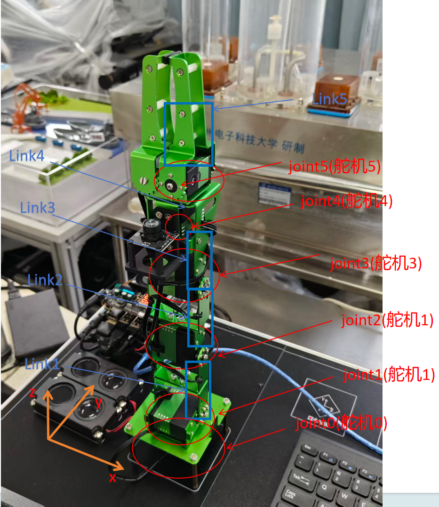

# 机器人建模与实验平台搭建实验结果

## 1. 实验目的

说明平台组成、机械臂树结构和URDF关节语义，整理编译、节点、关节话题与TF证据，为课程“机器人建模与实验平台设计”提供来源。

## 2. 实验环境

第一周：DICE白熊实训平台、11号实验箱、Jetson、实体五自由度机械臂加夹爪、USB相机。建模：原记录WSL2 Ubuntu20.04/ROS1 Noetic/WSLg。手册已确认主控系列为Jetson Nano、随臂USB相机与平台组成；【待补充：本实验箱设备铭牌、实际镜像与ROS完整版本】。

### 新增手册依据

[平台手册核对与页码索引](../../%E5%8F%82%E8%80%83%E8%B5%84%E6%96%99/%E5%B9%B3%E5%8F%B0%E6%89%8B%E5%86%8C%E6%A0%B8%E5%AF%B9.md)补充平台原理与默认连接。厂商说明采用Jetson Nano/Ubuntu18.04，介绍JetPack4.4/L4T32.4.3；这不等于本组实验当天的完整环境快照。所有成功率、原始CSV与报告日期保持原口径。手册示例图片不新增为本组实测证据。

## 3. 实验过程

第一周报告日期2026-09-14：连接实训平台/Jupyter，认识Servo ID0～5、主要Link/Joint及基座坐标系，完成基本操作并记录两组姿态。第二章材料在arm2026_ws：编辑Xacro、加载robot_description，GUI发布/joint_states，状态发布器建立TF，RViz显示模型；后续外观从53个visual更新到68个。此次只提取已有文件，没有复跑ROS或触发硬件。

## 4. 实验结果

| 测试编号 | 测试项目 | 测试条件 | 预期结果 | 实际结果 | 结论 |
|---|---|---|---|---|---|
| M1-01 | 平台连接 | 第一周JupyterLab | 稳定访问 | 报告记换电脑后稳定 | 报告记载通过 |
| M1-02 | URDF树解析 | 既有check_urdf.log | 单根无环 | root=base_link，11links/10joints | 历史解析通过；本次XML复核 |
| M1-03 | 工程构建 | 既有catkin_make.log | 构建目标完成 | Built target marm_description_xacro_generated_to_devel_space_ | 原Linux环境成功日志，导出副本入口有缺陷 |
| M1-04 | 关节与TF | rviz_validation.md | 关节输入改变末端TF | 零位[0,0,0.610]，改动后[-0.073,0.002,0.564]m | 既有运行文字记录；非本次测量 |
| M1-05 | RViz可见截图 | WSLg OpenGL视口 | 可见模型/坐标轴 | 捕捉接口黑屏，仅有离线预览 | 待补可见视口证据 |
| M1-06 | 相机图像话题 | 当前launch | 图像与模型统一启动 | launch未包含相机节点 | 尚未实现 |

## 5. 实验截图

图1-1：第一周报告word/media/image1.png，展示实体机械臂结构与基座坐标系；不能证明教学URDF与实物尺寸完全一致。

全部来源见[图片索引](figures/图片索引.md)。`figures/model_previews/`为原离线预览/结构图，不作为RViz运行截图。【待补充：RobotModel、TF坐标轴与关节GUI同屏截图】。

## 6. 实验数据

[模型静态结构](records/模型静态结构.json)从现有generated/marm.urdf提取：11links、10joints、68visual、9collision、0个标准inertial。独立Z1风格版本为57visual/13collision/9inertial，不能混为主模型统计。主模型质量宏调用未展开为标准惯性元素，当前证据支持几何/运动学教学，不支持完整动力学配置结论。

[既有运行记录](records/generated/rviz_validation.md)记零位TF translation=[0,0,0.610]m、RPY=[3.142,-1.571,0]rad；虚拟关节测试为joint1～6=[0.35,-0.70,0.95,-0.45,0.55,0.25]rad、finger_joint1=0.025m，末端变为translation=[-0.073,0.002,0.564]m、RPY=[0.578,-1.230,2.744]rad。它是已存文字记录，原始话题逐帧日志待补。

## 7. 遇到的问题及解决过程

- Jupyter掉线 → 报告分析USB虚拟网卡链路不稳定 → 更换电脑 → 报告记连接稳定，缺少网络诊断日志。
- RViz视口捕捉黑屏 → 原记录指向WSLg/OpenGL捕捉限制 → 保存节点/话题/TF记录并计划补拍 → 当前无可见RViz截图。
- 答辩报告53visual与当前68不一致 → 外观迭代版本不同 → 分别记录版本，不覆盖报告 → 当前XML计数68。
- 导出CMake入口成路径文本、launch缺省参数 → 历史环境与当前副本存在复现差异 → README提供另建运行副本的入口恢复和显式传参步骤 → 本次未在ROS环境执行验证。

## 8. 实验结论

主描述包、模型、launch和历史解析/编译/TF记录已归档。统一相机启动、图像话题、可见RViz证据、惯性宏有效性和与实体SDK的映射仍需补齐；不将独立Unitree参考包算作本组已实现的运动规划功能。

## 9. 原始材料索引

[原报告索引](original_reports/README.md)：第一周报告、第二章答辩版、第二章模板。原建模说明在本模块1.2_readme/source_notes；原任务书及课程报告模板在项目根课程要求与模板目录。模块2交叉引用第一周关节/夹爪数据。

新增参考：[手册PDF第19页](../../%E5%8F%82%E8%80%83%E8%B5%84%E6%96%99/DICE_%E7%99%BD%E7%86%8A%E4%BA%BA%E5%B7%A5%E6%99%BA%E8%83%BD%E5%AE%9E%E8%AE%AD%E5%B9%B3%E5%8F%B0%E7%94%A8%E6%88%B7%E6%89%8B%E5%86%8C.pdf#page=19)；[平台手册核对与页码索引](../../%E5%8F%82%E8%80%83%E8%B5%84%E6%96%99/%E5%B9%B3%E5%8F%B0%E6%89%8B%E5%86%8C%E6%A0%B8%E5%AF%B9.md)。
