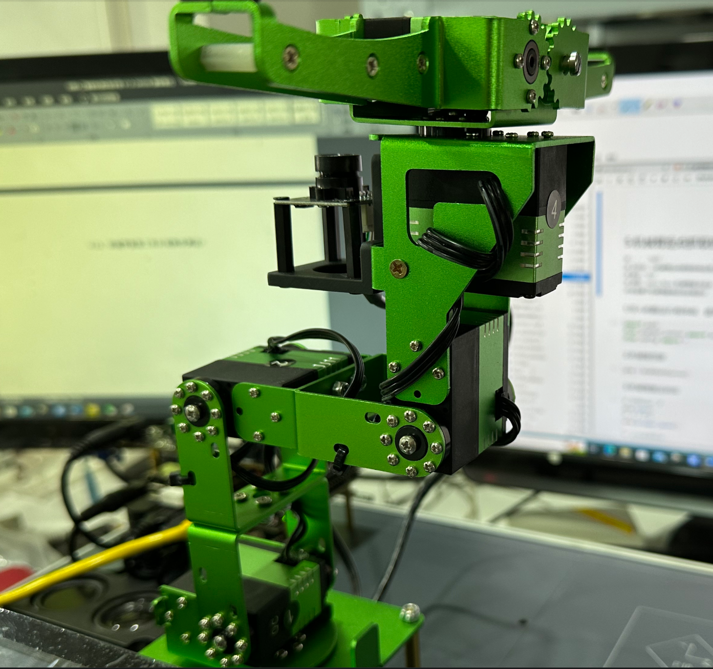
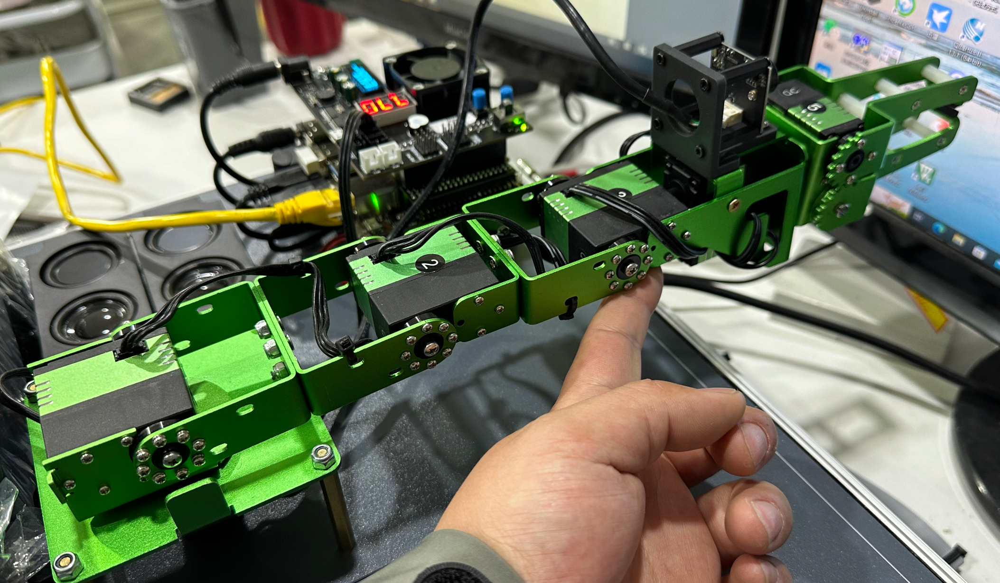
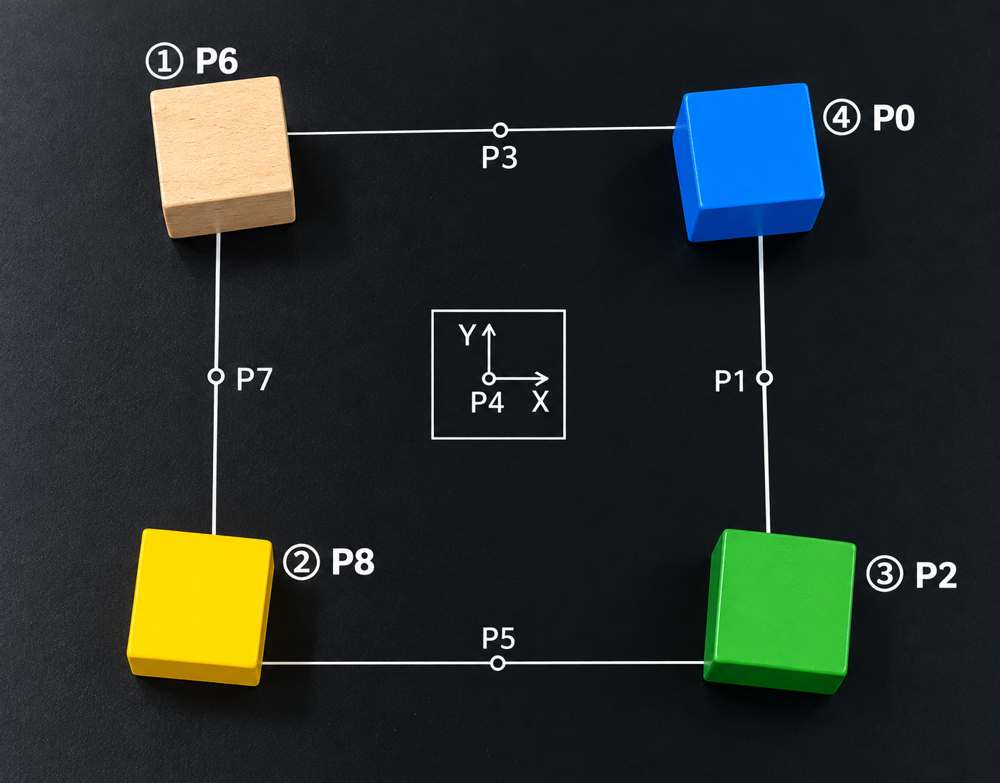
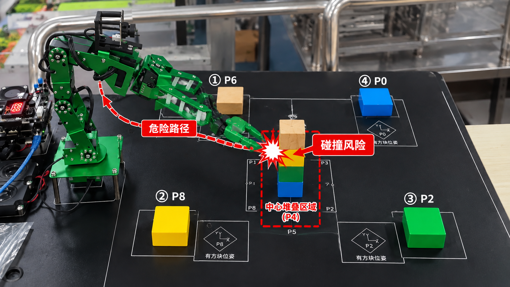
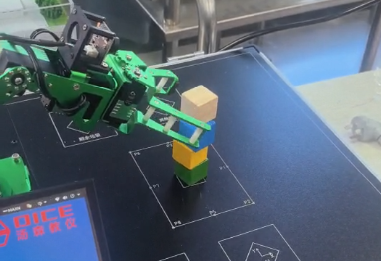
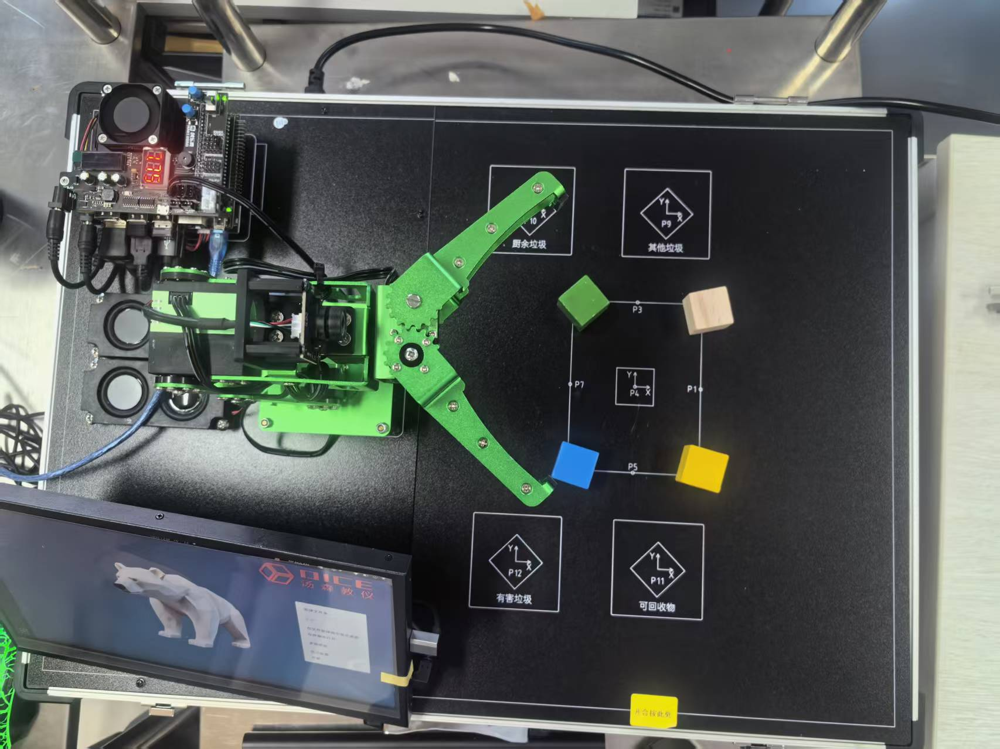
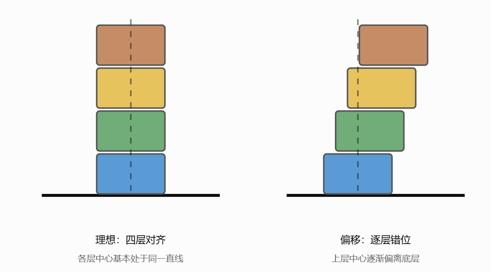

# 图片来源与图题

保留原始字节及宽高比。图中数值只按原图或报告说明解释；流程示意与离线预览单独标记。

## 图2-1 手册标准姿态图5.7.1（原报告引用），非本组实拍

来源 `week1/第11组(1).docx!/word/media/image2.png`，OOXML段落索引113；原报告上下文：3.4 两组姿态/标定记录  姿态A       姿态B 姿态

## 图2-2 手册标准姿态图5.7.2（原报告引用），非本组实拍

来源 `week1/第11组(1).docx!/word/media/image3.png`，OOXML段落索引113；原报告上下文：3.4 两组姿态/标定记录  姿态A       姿态B 姿态

## 图2-3 目标工作区与方块位置，按原报告图题使用

来源 `week3/11组_第三章_四个堆叠方块归位_实验报告.docx!/word/media/image1.png`，OOXML段落索引129；原报告上下文：179.2  图1  目标点 P0/P2/P6/P8 与中央 P4 的位置示意图 2. 夹爪开闭及 Pick & Place 流程

## 图2-4 低位横移与P4碰撞风险的说明配图

来源 `week3/11组_第三章_四个堆叠方块归位_实验报告.docx!/word/media/image2.png`，OOXML段落索引143；原报告上下文：机械臂运动遵循“先升高，再横移”的安全原则。抓取后先回到 Approach，再经 Home 高位转移；放置时先到 Place Above，再下降至 Place，目标上方安全点比实际放置点高 55 mm。第4层 Pick Z=13.8 mm，距离桌面最近，因此设置 MIN_PICK_Z=10.0 mm，并避免在低位直接横移。  图3  机械臂低位横移与 P4 堆叠物块碰撞风险示意图 4. 控制指令与动作等待

## 图2-5 原报告中的实物堆叠现场照片

来源 `week4/11组_第四章_四方块自动堆叠_报告模板.docx!/word/media/image1.png`，OOXML段落索引53；原报告上下文：本次实验将第三章的“中央方块依次归位到四个区域”反向应用：从四个已标定区域抓取方块，再运送至中央 P4，由下至上形成四层方块塔。代码中四个来源区依次为 P0、P2、P8、P6；对应模板中的 A、B、C、D，分别堆放在第1至第4层。  1.2 安全路径与动作顺序 单块作业过程为：Home → 夹爪张开 → Pick Above（抓取上方点）→ Pick（抓取）→ 夹爪闭合 → Lift（抬升）→ Home（转移过渡）→ Place Above（放置上方点）→ Place（放置）

## 图2-6 四区来源方块与机械臂现场照片

来源 `week4/11组_第四章_四方块自动堆叠_报告模板.docx!/word/media/image2.jpeg`，OOXML段落索引53；原报告上下文：本次实验将第三章的“中央方块依次归位到四个区域”反向应用：从四个已标定区域抓取方块，再运送至中央 P4，由下至上形成四层方块塔。代码中四个来源区依次为 P0、P2、P8、P6；对应模板中的 A、B、C、D，分别堆放在第1至第4层。  1.2 安全路径与动作顺序 单块作业过程为：Home → 夹爪张开 → Pick Above（抓取上方点）→ Pick（抓取）→ 夹爪闭合 → Lift（抬升）→ Home（转移过渡）→ Place Above（放置上方点）→ Place（放置）

## 图2-7 堆叠对齐与倾斜示意图，原理说明，非实测证据

来源 `week4/11组_第四章_四方块自动堆叠_报告模板.docx!/word/media/image3.png`，OOXML段落索引251；原报告上下文：机械臂完成抓取和放置动作，并不代表方块一定能够整齐堆叠。在实际操作中，还需要考虑方块位置、夹持姿态、放置高度和退出动作等因素。特别是四层堆叠时，下层的偏差可能影响上层，使整个方块塔出现错位或倾斜。  表9 四方块堆叠问题、原因及改进方法分析 问题或现象

## 手册来源复核

image2.png对应[手册PDF第226页](../../../%E5%8F%82%E8%80%83%E8%B5%84%E6%96%99/DICE_%E7%99%BD%E7%86%8A%E4%BA%BA%E5%B7%A5%E6%99%BA%E8%83%BD%E5%AE%9E%E8%AE%AD%E5%B9%B3%E5%8F%B0%E7%94%A8%E6%88%B7%E6%89%8B%E5%86%8C.pdf#page=226)，image3.png对应[手册PDF第227页](../../../%E5%8F%82%E8%80%83%E8%B5%84%E6%96%99/DICE_%E7%99%BD%E7%86%8A%E4%BA%BA%E5%B7%A5%E6%99%BA%E8%83%BD%E5%AE%9E%E8%AE%AD%E5%B9%B3%E5%8F%B0%E7%94%A8%E6%88%B7%E6%89%8B%E5%86%8C.pdf#page=227)。人工查看原图并以特征匹配复核为同源裁切/缩放照片，仅用于标准姿态示意。原报告/图片字节未改动。
