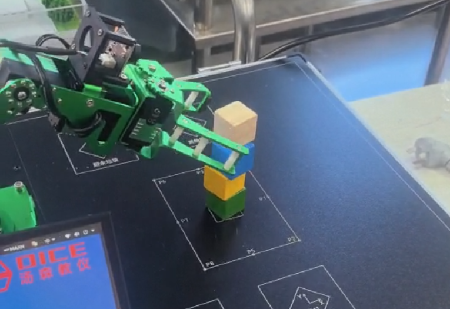

# 机械臂运动控制实验结果

## 1. 实验目的

整理单/多关节控制、夹爪开合、点位运动、多航点抓放、四块归位与堆叠的实际记录，并区分程序动作、人工成功判定和定位精度测量。

## 2. 实验环境

DICE实验箱11号、Jetson/Linux/Jupyter、五轴实体机械臂加夹爪；Notebook元数据Python3.8.10，SDK为Arm5DoFUServo/Arm5DoFKinematic，新增真机库和标定配置已补齐，尚需确认与原实验版本一致。手册已有Arm5DoF示例、串口与标定说明；【待补充：SDK部署版本、关节标定的现场对应与设备铭牌】。

### 新增手册依据

[平台手册核对与页码索引](../../%E5%8F%82%E8%80%83%E8%B5%84%E6%96%99/%E5%B9%B3%E5%8F%B0%E6%89%8B%E5%86%8C%E6%A0%B8%E5%AF%B9.md)补充平台原理与默认连接。厂商说明采用Jetson Nano/Ubuntu18.04，介绍JetPack4.4/L4T32.4.3；这不等于本组实验当天的完整环境快照。所有成功率、原始CSV与报告日期保持原口径。手册示例图片不新增为本组实测证据。

## 3. 实验过程

week1：单关节、抬臂、腕部±20°摆动、夹爪30°与0°交替、Home和反馈采样。week3报告日期2026-09-28：从中央四层自上至下抓取，经Approach/Lift/Home/Place Above放到四区；完成3轮。week4：P0/P2/P8/P6依次抓取回堆中央第1～4层，每块由独立Cell启动，报告记录3轮。

week3代码TARGETS为P0/P2/P6/P8，报告为P6/P8/P2/P0；因此保留报告中的区域成功记录，不把每块时序强行对应当前代码。week4注释声称反向复制“当前Ch3”，其来源点与Roll又有独立修正，不能自动当作现有week3的完全逆过程。

## 4. 实验结果

| 测试编号 | 测试项目 | 测试条件 | 预期结果 | 实际结果 | 结论 |
|---|---|---|---|---|---|
| M2-01 | 单关节/多关节 | 第一周报告 | 指定动作执行 | 报告勾选完成，记录腕部往复2次 | 报告记载，无对应独立源码 |
| M2-02 | 夹爪/复位 | 第一周打招呼流程 | 开闭并返回Home | 报告记开合2次成功、返回Home成功 | 定性通过 |
| M2-03 | 四块归位第1轮 | 示教点位 | 4块归位 | 4/4正确 | 报告记载通过 |
| M2-04 | 四块归位第2轮 | 同类场景 | 4块归位 | P0偏移，3/4正确 | 有1次位置判定失败 |
| M2-05 | 四块归位第3轮 | 同类场景 | 4块归位 | 4/4正确 | 报告记载通过 |
| M2-06 | 四层堆叠第1轮 | 分块Cell启动 | 四层塔 | 第3/4层失败，2/4 | 报告记载失败 |
| M2-07 | 四层堆叠第2/3轮 | 同类场景 | 四层塔 | 两轮均4/4 | 报告记载通过 |
| M2-08 | 位姿逆解 | week4已有输出 | 20项关键姿态可解 | 已存输出含20项IK OK | 原Notebook计算记录；非实物成功判定 |

## 5. 实验截图

图2-1：week4原报告word/media/image1.png，展示堆叠场景，不用于逐轮成功率独立复核。姿态照片、四区现场和风险说明配图见[图片来源与图题](figures/图片索引.md)。

原始演示视频保留在[视频目录](../../../homework/results/motion_control/videos/)；本次未将视频逐帧计数，不据此新增统计样本。

手册复核发现：`figures/report_week1/image2.png`与`image3.png`分别引用PDF第226页图5.7.1、第227页图5.7.2。两图仅为厂商标准姿态示意，不作为本组实拍或反馈测量证据。对比结果见[配图同源复核记录](../../%E6%95%B4%E7%90%86%E8%AE%B0%E5%BD%95/%E6%89%8B%E5%86%8C%E9%85%8D%E5%9B%BE%E5%90%8C%E6%BA%90%E6%A0%B8%E5%AF%B9.json)。

## 6. 实验数据

week3报告表转录[12块次CSV](../../../homework/results/motion_control/data/week3_%E6%8A%A5%E5%91%8A%E6%B5%8B%E8%AF%95%E8%A1%A8%E8%BD%AC%E5%BD%95.csv)：11/12×100%=91.67%，完整四块成功轮次2/3。week4报告表转录[12块次CSV](../../../homework/results/motion_control/data/week4_%E6%8A%A5%E5%91%8A%E6%B5%8B%E8%AF%95%E8%A1%A8%E8%BD%AC%E5%BD%95.csv)：10/12×100%=83.33%，完整四层成功轮次2/3。两组任务分别统计，转录表不是新原始测量。

第一周原始舵机姿态A=[1.4,-1.6,-88.4,90.3,3.1,97.7]°，B=[-86.2,92.0,-0.1,0.7,3.1,-0.7]°，按Servo ID0～5。目标角与此反馈尚未经过同一标定坐标换算，不能直接当角度误差。

week4保留输出摘录[Notebook原输出](records/notebook_outputs/Week4_堆叠.txt)。点位表仍在原Notebook，参数未改动。【待补充：P0偏移方向/距离、重复定位误差、各次任务的视频时间段及逐次原始日志】。

按[手册PDF第227页](../../../homework/docs/references/DICE_%E7%99%BD%E7%86%8A%E4%BA%BA%E5%B7%A5%E6%99%BA%E8%83%BD%E5%AE%9E%E8%AE%AD%E5%B9%B3%E5%8F%B0%E7%94%A8%E6%88%B7%E6%89%8B%E5%86%8C.pdf#page=227)～[手册PDF第230页](../../../homework/docs/references/DICE_%E7%99%BD%E7%86%8A%E4%BA%BA%E5%B7%A5%E6%99%BA%E8%83%BD%E5%AE%9E%E8%AE%AD%E5%B9%B3%E5%8F%B0%E7%94%A8%E6%88%B7%E6%89%8B%E5%86%8C.pdf#page=230)的 `a=kθ+b` 先将原始反馈角°换成关节弧度，才可与目标比较。报告第5通道A/B均3.1°，与手册要求的不同标准关节姿态无法形成可逆映射；因此继续保留标定复测事项，不将手册标准系数或示例当作本组实测标定。

## 7. 遇到的问题及解决过程

- week3第二、三层Approach无逆解 → 原Roll归一化83.7°不在该配置可行区 → 当前代码改为90°并显式设上方点 → 报告记修正后可执行，新增库可做纯运动学复核，但不能据此替代原真机试验。
- 第2轮P0放置偏移 → 原报告列举夹持中心/摆放/定位等候选原因 → 建议同条件复测、记录方向距离后微调 → 第3轮恢复正确，不能归因于未记录的调参。
- week4首次高层失败 → 第3/4层退出高度差仅5/1mm为候选风险 → 报告提出提高净空及复核释放姿态 → 后两轮成功，但没有控制变量证明原因。
- 第一周标定K接近0 → 采样顺序/姿态差异待核查 → 保留原始两组反馈、计划重测 → 尚无可确认的新标定结果。

## 8. 实验结论

已有点位抓放、归位和分层堆叠实现与报告证据。成功率分别来自报告12块次表，未替代实体定位精度指标。SDK/config现已补齐；实验中的姿态无逆解已通过取模和可行边界修正解决。旧副本离线结果另作版本差异保留，最终成功率与实际效果以实验报告为准；原源码与参数没有为对齐报告而改动。

## 9. 原始材料索引

[原报告索引](original_reports/README.md)链接week3、week4副本与模块1保存的week1报告。week4文件名虽含“报告模板”，正文已包含参数与三轮结果；第二章空白模板不当作实验成功证据。两段既有MP4归本模块records/videos。

新增参考：[手册PDF第229页](../../../homework/docs/references/DICE_%E7%99%BD%E7%86%8A%E4%BA%BA%E5%B7%A5%E6%99%BA%E8%83%BD%E5%AE%9E%E8%AE%AD%E5%B9%B3%E5%8F%B0%E7%94%A8%E6%88%B7%E6%89%8B%E5%86%8C.pdf#page=229)；[平台手册核对与页码索引](../../%E5%8F%82%E8%80%83%E8%B5%84%E6%96%99/%E5%B9%B3%E5%8F%B0%E6%89%8B%E5%86%8C%E6%A0%B8%E5%AF%B9.md)。
