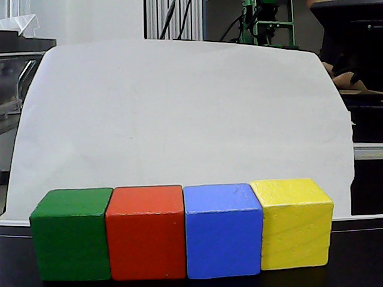
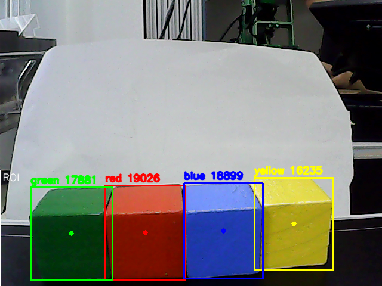
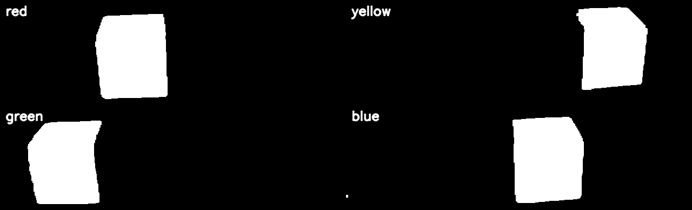
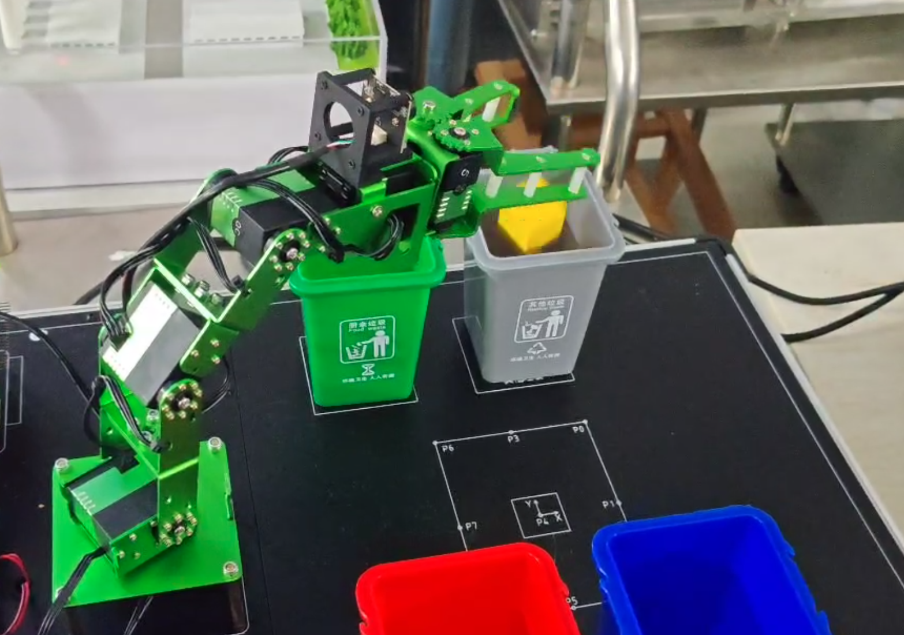

# 视觉目标识别与自动分拣实验结果

## 1. 实验目的

核实四色HSV识别、像素中心提取与固定P4自动投桶，分别评价颜色真值包含、唯一目标判定、调试执行状态与人工入桶成功。

## 2. 实验环境

第5周报告日期2026-10-19，记Jetson/Linux、USB UVC相机640×480、Python3.8、OpenCV/NumPy/Jupyter。第6周报告封面2026-10-12，调试CSV实际时间2026-10-26，二者日期冲突【待补充：实验六实际日期与报告封面校正依据】。主分拣Notebook依赖的课程SDK/config现已补齐；参考相机映射与vconfig也已加入，但它们与本周固定P4主程序的联调尚无实测依据。

### 新增手册依据

[平台手册核对与页码索引](../../%E5%8F%82%E8%80%83%E8%B5%84%E6%96%99/%E5%B9%B3%E5%8F%B0%E6%89%8B%E5%86%8C%E6%A0%B8%E5%AF%B9.md)补充平台原理与默认连接。厂商说明采用Jetson Nano/Ubuntu18.04，介绍JetPack4.4/L4T32.4.3；这不等于本组实验当天的完整环境快照。所有成功率、原始CSV与报告日期保持原口径。手册示例图片不新增为本组实测证据。

## 3. 实验过程

week5取帧→ROI/整图→HSV四色Mask→5×5开闭运算→轮廓面积筛选→框中心与标签→保存同帧三图与人工真值测试。绿色V下限50降35；保留20组原始证据。week6固定P4唯一同色连续5帧触发→夹取→home转运→对应桶上方释放→home→拍摄位→检查P4→RESET后重新开放。像素中心未用于转换抓取XYZ。

## 4. 实验结果

| 测试编号 | 测试项目 | 测试条件 | 预期结果 | 实际结果 | 结论 |
|---|---|---|---|---|---|
| M3-01 | 红色单块 | 4条CSV | 唯一目标且同色 | 4/4 correct | 当前样本100% |
| M3-02 | 黄色单块 | 3条CSV | 唯一目标且同色 | 1/3 correct | 2条含额外目标 |
| M3-03 | 绿色单块 | 15条CSV | 唯一目标且同色 | 14/15 correct | 1条含额外目标 |
| M3-04 | 蓝色单块 | 6条CSV | 唯一目标且同色 | 3/6 correct | 3条多目标/裂块 |
| M3-05 | 同帧四色 | 既有raw/result/masks | 四类轮廓可见 | 20组图中的同框及逐色画面 | 图像定性证据，非额外测试数 |
| M3-06 | 分拣调试 | 44条动作CSV | 按流程执行 | 35条P4已清空待确认、8条失败、1条夹取未成功 | 不能由35条推算入桶成功率 |
| M3-07 | 最终两轮分拣 | 两轮各红黄绿蓝 | 实际落入对应桶 | 人工CSV与报告均8/8成功 | 固定顺序人工观察样本100% |
| M3-08 | 5帧去抖/BUSY | 当前代码静态检查 | 唯一连续色触发、忙碌拒绝 | 有对应分支；报告截图为调试状态 | 时间连续性和误触发率待实证 |

## 5. 实验截图

图3-1来源：week5/5.目标识别/evidence同名PNG。

图3-2：与图3-1同帧，显示颜色、框和中心；不作为独立一次测试。

图3-3：同组Masks反映阈值分割，来源与图3-1相同时间戳。

图3-4：week6/week6_.docx的word/media/image6.png，桶上方投放现场。完整60张原始图、报告配图及逐图来源见[图片索引](figures/图片索引.md)。示意流程与统计插图另有标记，不当作独立实拍。

## 6. 实验数据

[week5原始CSV](../../../homework/results/vision_sorting/data/week5_test_records.csv)有28行，result=correct共22行，严格判定准确率 `A=C/N=22/28=78.57%`；C为唯一目标且颜色匹配的记录数，N为真实测试行数。按CSV检测颜色集合，28条均包含真值色，但这只表示“真值颜色被包含”，多目标或多色误检仍会失败，不能称全部颜色阈值已可靠。

6条失败为第15、16、18、20、23、24行（从1计），object_count均非1。CSV的note均为空，报告中逐条解释属于报告描述，不能倒写成原始CSV备注。CSV时间与截图没有逐行ID绑定，不能宣称某张截图精确对应某行。课程Ch5建议40次/≥36次正确；当前尚缺至少12次实际测试，28条不能直接折算成满足该要求。

[week6调试日志](../../../homework/results/vision_sorting/data/week6_action_log.csv)有44行完整编号1～44，35条P4清空、8条失败、1条夹取未成功。P4清空只能说明原区域未再检出同色，不能证明落桶。另有[两轮8次人工表](../../../homework/results/vision_sorting/data/%E4%B8%A4%E8%BD%AE8%E6%AC%A1%E5%88%86%E6%8B%A3%E8%AE%B0%E5%BD%95.csv)，每色2次均记成功，成功率 `8/8=100%`；记录依据明确写“未与日志逐条对应”，不能将其拼接到44行日志计算统一成功率。

Ch6要求8次随机测试且建议≥7次成功；现有两轮顺序均红黄绿蓝，只证明固定顺序。统计计算结果见[统计核对JSON](records/统计核对.json)。唯一现存events.jsonl在records/history，为旧frank_week6连接时未确认物理标定的异常日志，不是22条手势回执。

## 7. 遇到的问题及解决过程

- 绿色正面漏检 → 报告记录V约40～48，旧V≥50过高 → 主Notebook降低到35 → 报告给同帧面积5326→17652px的比较；其统计ROI/原始脚本待进一步复核。
- 额外轮廓/裂块 → 背景、反光、手腕入镜等为报告分析 → ROI/阈值/形态学联合调试 → 严格CSV仍有6条失败，不能写成全部解决。
- 抓取点/桶位逆解不可达 → 调试日志明确报错 → 当前位姿表包含99.5°蓝桶Pitch → 后续有P4清空记录，缺参数修正前后逐项对照。
- P4仍有方块或预览停止 → 抓取失败/结果无法核查 → 程序进入ERROR并停止继续任务 → 日志保留失败，待人工检查，不覆盖为成功。

## 8. 实验结论

独立识别与固定P4抓放投桶有代码、报告和原始数据支持；28条严格识别准确率78.57%，人工最终8次入桶均成功。任意位置坐标标定抓取、严格乱序、连续帧时序实证和日志对齐仍待补。原CLI与主Notebook阈值/评分不同，数据按生成规则解释。

## 9. 原始材料索引

[原报告索引](original_reports/README.md)包含实验5终稿及week6报告；第5周手势扩展只交叉引用模块4，不新增颜色测试数。Ch5任务PDF原在week5目录，Ch6/7/8 PDF由week5/5.目标识别.zip提取至项目根课程要求与模板；ZIP成员清单可追溯原始来源。bin_map.csv、44行日志及8行人工表原样保存。

新增参考：[手册PDF第266页](../../../homework/docs/references/DICE_%E7%99%BD%E7%86%8A%E4%BA%BA%E5%B7%A5%E6%99%BA%E8%83%BD%E5%AE%9E%E8%AE%AD%E5%B9%B3%E5%8F%B0%E7%94%A8%E6%88%B7%E6%89%8B%E5%86%8C.pdf#page=266)；[平台手册核对与页码索引](../../%E5%8F%82%E8%80%83%E8%B5%84%E6%96%99/%E5%B9%B3%E5%8F%B0%E6%89%8B%E5%86%8C%E6%A0%B8%E5%AF%B9.md)。
