# 图片来源与图题

保留原始字节及宽高比。图中数值只按原图或报告说明解释；流程示意与离线预览单独标记。

## 图4-1 手势—网络—SDK架构说明图，非实验截图

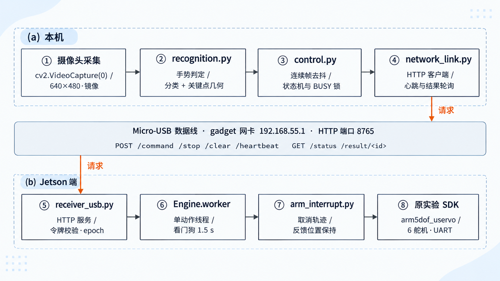

来源 `week7/实验七  手势识别与机械臂指令控制-第11组.docx!/word/media/image1.png`，OOXML段落索引101；原报告上下文：整体链路见图 1：本机只做拍摄与识别，指令经 Micro-USB gadget 网络的 HTTP 服务送到 Jetson，Jetson 用原实验 SDK 驱动 6 个舵机；端口 8765 是接收服务，8888 是 JupyterLab，两者用途不同。状态机见图 2。   图1  系统链路：本机识别 → USB 网络 HTTP → Jetson 接收 → 原 SDK → 机械臂

## 图4-2 手势状态机与停止路径说明图，非运行状态取证

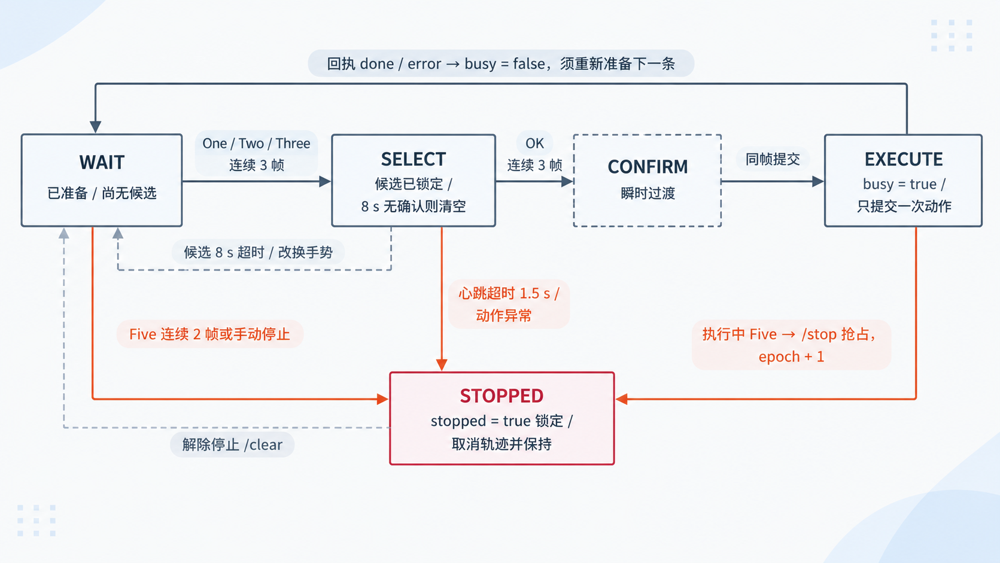

来源 `week7/实验七  手势识别与机械臂指令控制-第11组.docx!/word/media/image2.png`，OOXML段落索引106；原报告上下文：上电顺序上，接收端启动即处于 locked（stopped=True）状态，必须由本机先发 /clear 解除，再由界面“准备下一条”置 armed；这样即使误连也不会立刻动作。   图2  手势指令状态机与停止路径

## 图4-3 One识别截图，报告读数0.809

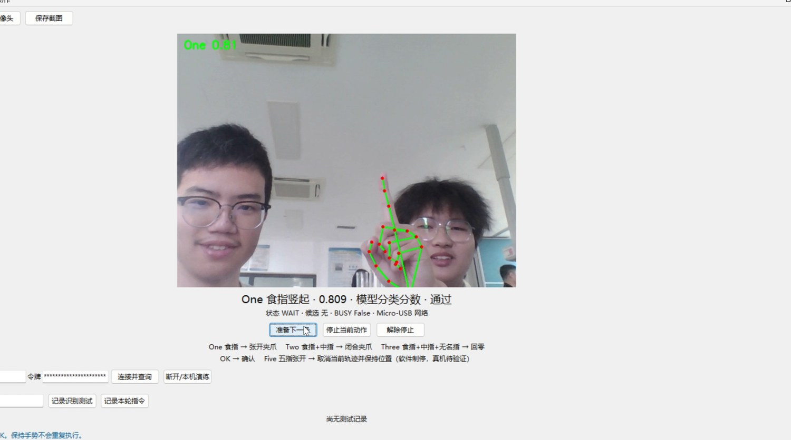

来源 `week7/实验七  手势识别与机械臂指令控制-第11组.docx!/word/media/image3.jpg`，OOXML段落索引196；原报告上下文：识别结果实时叠加在画面上，依次给出“类别 + 分数 + 分数来源 + 通过状态”，绿色为通过、黄色为未通过；骨架由 MediaPipe 的 21 个关键点直接绘于原始帧，未经任何后期修饰。  图3  One（食指竖起）0.809，模型分类分数，状态 WAIT，候选为空

## 图4-4 Two识别截图，报告读数0.894，SELECT

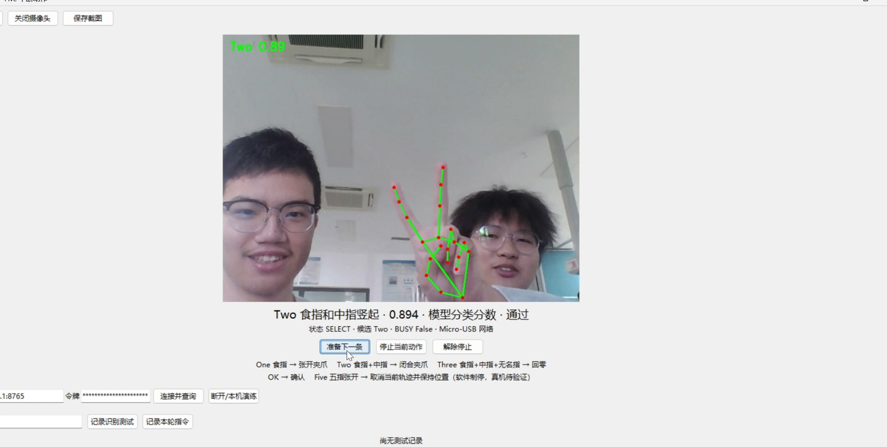

来源 `week7/实验七  手势识别与机械臂指令控制-第11组.docx!/word/media/image4.jpg`，OOXML段落索引198；原报告上下文：图3  One（食指竖起）0.809，模型分类分数，状态 WAIT，候选为空  图4  Two（食指+中指）0.894，模型分类分数，状态 SELECT，候选 Two，BUSY False

## 图4-5 Three识别截图，几何分数0.764

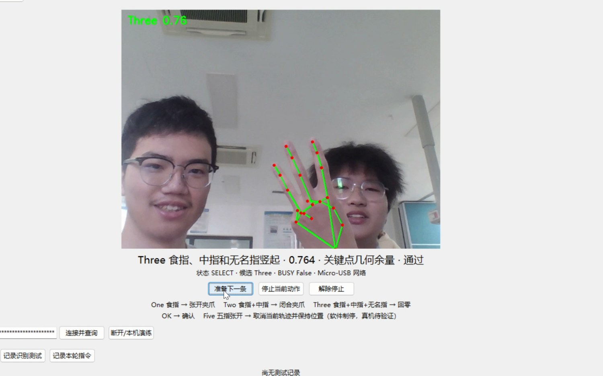

来源 `week7/实验七  手势识别与机械臂指令控制-第11组.docx!/word/media/image5.jpg`，OOXML段落索引200；原报告上下文：图4  Two（食指+中指）0.894，模型分类分数，状态 SELECT，候选 Two，BUSY False  图5  Three（食指、中指、无名指）0.764，关键点几何余量，状态 SELECT，候选 Three 图 3～图 5 分别对应三种“选择”手势。可以看到同一时刻只会出现一个候选：One 出现时状态仍是 WAIT（尚未凑满 3 帧），Two 与 Three 出现时已经进入 SELECT。Three 的分数来源写作“关键点几何余量”，与 One/Two 的“模型分类

## 图4-6 OK确认Two，几何分数0.929，EXECUTE/BUSY

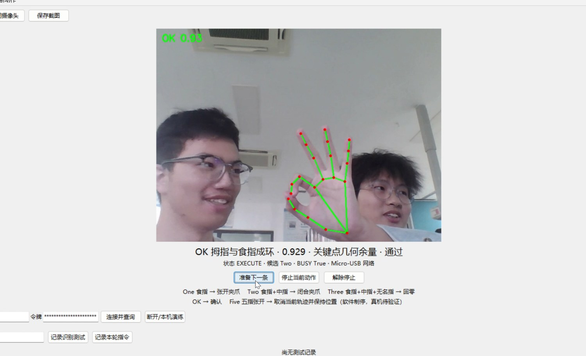

来源 `week7/实验七  手势识别与机械臂指令控制-第11组.docx!/word/media/image6.jpg`，OOXML段落索引203；原报告上下文：图 3～图 5 分别对应三种“选择”手势。可以看到同一时刻只会出现一个候选：One 出现时状态仍是 WAIT（尚未凑满 3 帧），Two 与 Three 出现时已经进入 SELECT。Three 的分数来源写作“关键点几何余量”，与 One/Two 的“模型分类分数”不同——Three 不是模型类别，而是用食指、中指、无名指伸直比值 ≥1.85、小指弯曲比值 ≤1.55 判出来的，分数是 min(0.99, 0.70+余量) 的映射值，不能当成概率写。  图6  OK 0.9

## 图4-7 OK确认One，几何分数0.958，EXECUTE/BUSY

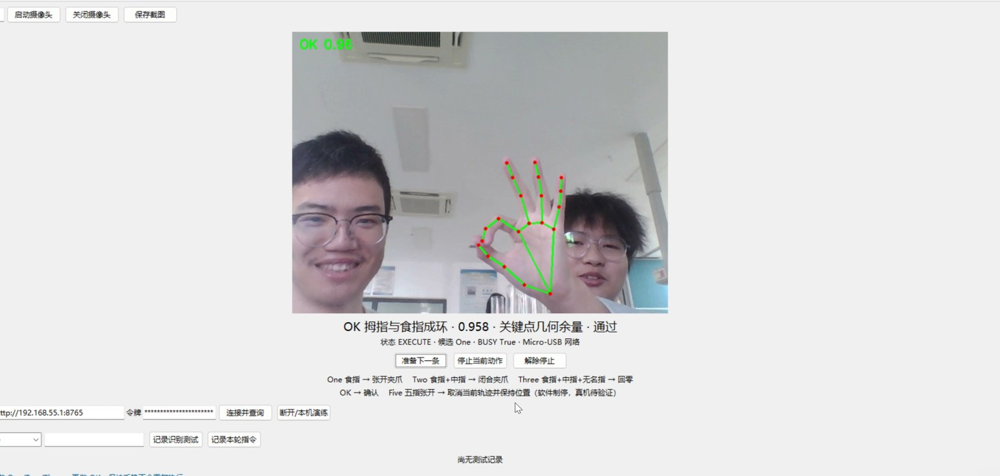

来源 `week7/实验七  手势识别与机械臂指令控制-第11组.docx!/word/media/image7.jpg`，OOXML段落索引205；原报告上下文：图6  OK 0.929，候选 Two，状态 EXECUTE，BUSY True（确认后同帧提交闭合夹爪）  图7  OK 0.958，候选 One，状态 EXECUTE，BUSY True（确认后同帧提交张开夹爪） 图 6、图 7 是 OK 确认的同一帧：候选仍显示为 Two / One，状态已经是 EXECUTE、BUSY 为 True，说明确认与提交在同一帧内完成，中间没有可截图的 CONFIRM 停留。两张图的 OK 分数分别为 0.929 与 0.958，都由环距

## 图4-8 Five分数0.60未通过，不能作为成功停止证据

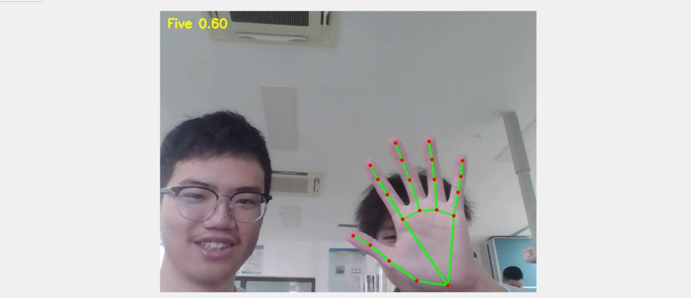

来源 `week7/实验七  手势识别与机械臂指令控制-第11组.docx!/word/media/image8.jpg`，OOXML段落索引208；原报告上下文：图 6、图 7 是 OK 确认的同一帧：候选仍显示为 Two / One，状态已经是 EXECUTE、BUSY 为 True，说明确认与提交在同一帧内完成，中间没有可截图的 CONFIRM 停留。两张图的 OK 分数分别为 0.929 与 0.958，都由环距 dist(4,8)/dist(5,17) 与三指伸直余量算出。  图8  Five 0.60，低于 0.70 阈值判为未通过（黄色标注），不进入停止逻辑 图 8 是阈值作用的直接证据：手指张开幅度不够、掌心偏斜时 Op

## 图4-9 张爪动作前，报告录像抽帧

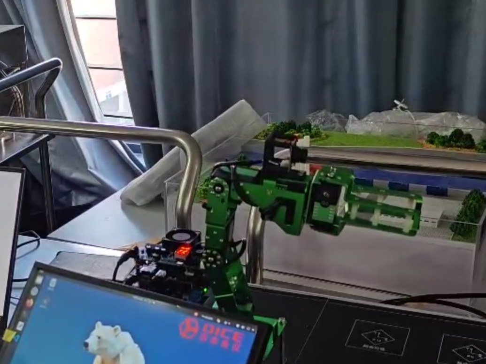

来源 `week7/实验七  手势识别与机械臂指令控制-第11组.docx!/word/media/image9.jpg`，OOXML段落索引213；原报告上下文：动作过程以“前 / 后”成对截帧呈现，取自现场录像 VID_20261026_142404.mp4，每组两帧对应同一次动作的起止；图 9、图 10 按同一尺度裁至夹爪特写，左为动作前、右为动作后，便于直接比对。   图9(a)  动作前：食指竖起（One）

## 图4-10 张爪动作后，报告录像抽帧

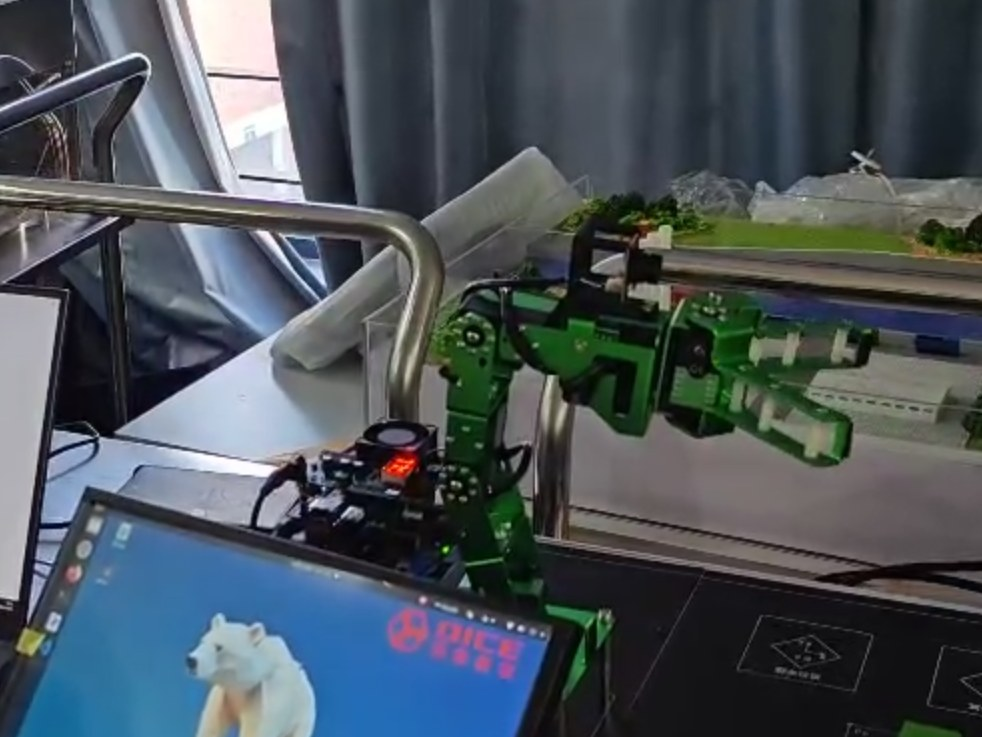

来源 `week7/实验七  手势识别与机械臂指令控制-第11组.docx!/word/media/image10.jpg`，OOXML段落索引214；原报告上下文：  图9(a)  动作前：食指竖起（One） 图9(b)  动作后：夹爪张开

## 图4-11 闭爪动作前，报告录像抽帧

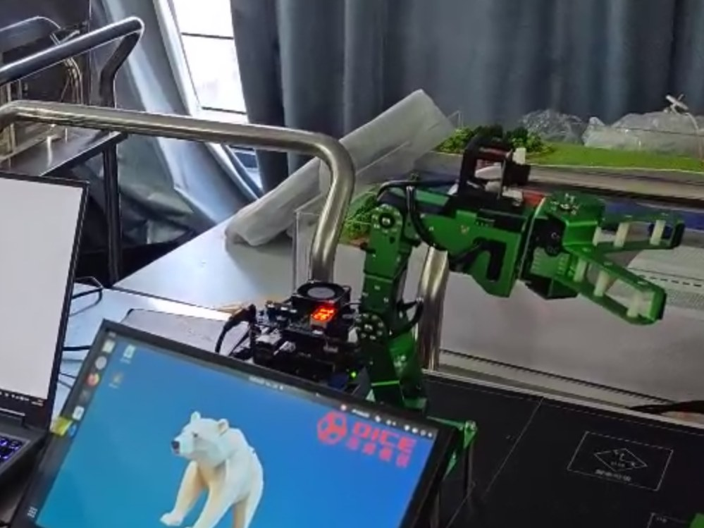

来源 `week7/实验七  手势识别与机械臂指令控制-第11组.docx!/word/media/image11.jpg`，OOXML段落索引219；原报告上下文：图 9：抬出 One 后，两块夹爪由并拢张开至明显分离，开口由约一指宽增至三指宽，动作平稳无异响；日志对应 14:10:34 的 open_gripper 回执 done。两图同尺度裁切，开口变化可直接目视比对。   图10(a)  动作前：Two 手势

## 图4-12 闭爪动作后，报告录像抽帧

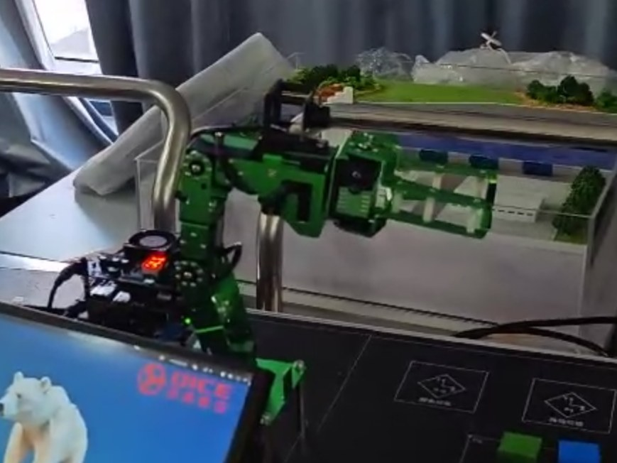

来源 `week7/实验七  手势识别与机械臂指令控制-第11组.docx!/word/media/image12.jpg`，OOXML段落索引220；原报告上下文：  图10(a)  动作前：Two 手势 图10(b)  动作后：夹爪闭合

## 图4-13 回零前姿态，报告录像抽帧

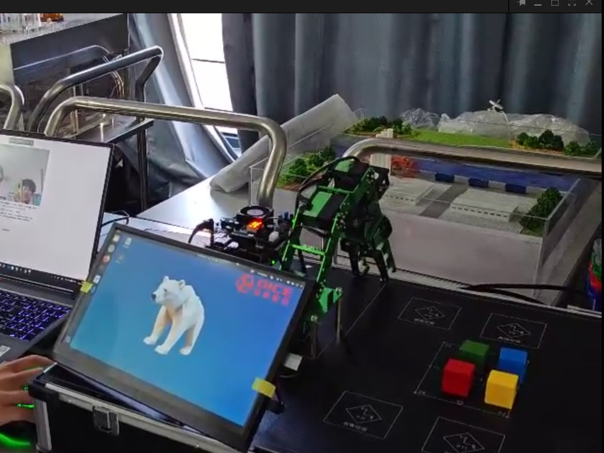

来源 `week7/实验七  手势识别与机械臂指令控制-第11组.docx!/word/media/image13.jpg`，OOXML段落索引253；原报告上下文：复位演示用 Three + OK 触发 home：SDK 以 T=2.0 s 软运动回零，逆解失败会抛 RuntimeError 而不是静默返回。图 11 是回零前后的对照。   图11(a)  回零前：大臂近乎直立、夹爪朝下

## 图4-14 回零后姿态，报告录像抽帧

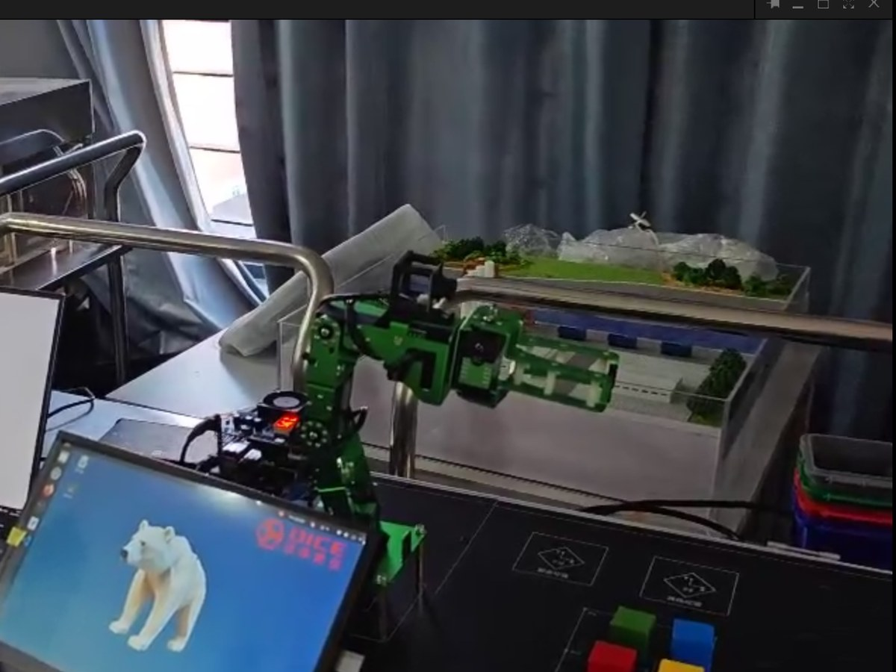

来源 `week7/实验七  手势识别与机械臂指令控制-第11组.docx!/word/media/image14.jpg`，OOXML段落索引254；原报告上下文：  图11(a)  回零前：大臂近乎直立、夹爪朝下 图11(b)  回零后：末端前伸至水平零位

## 图4-15 报告所述Five停止现场画面；缺少对应interrupted与角度时间序列

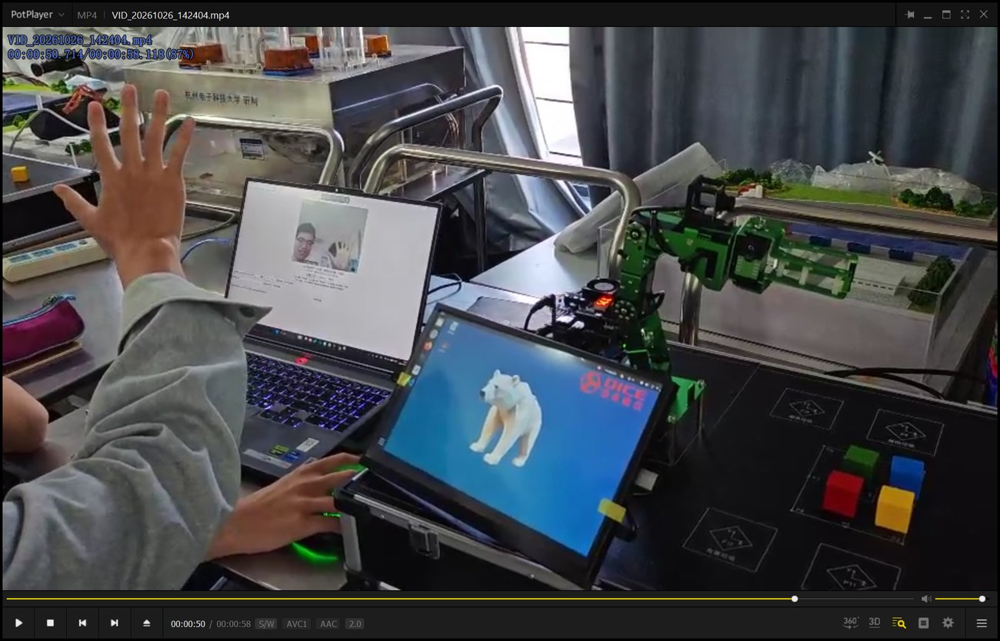

来源 `week7/实验七  手势识别与机械臂指令控制-第11组.docx!/word/media/image15.jpg`，OOXML段落索引259；原报告上下文：图 11：回零前后姿态差别明显——起始时大臂近乎直立、夹爪朝下，动作结束后末端前伸到水平位并停住；日志对应 14:11:36 / 14:12:01 / 14:12:18 的三次 home 回执 done。这里只描述画面里能看到的几何变化；具体的六个关节角由 SDK 内部给定，本组没有另做角度测量，所以不写成“角度误差小于 X 度”这类无法佐证的结论。  图12  Five 五指张开：软件制停请求发出后机械臂停在当时姿态 图 12 是停止路径的现场画面：抬 Five 后停止请求
