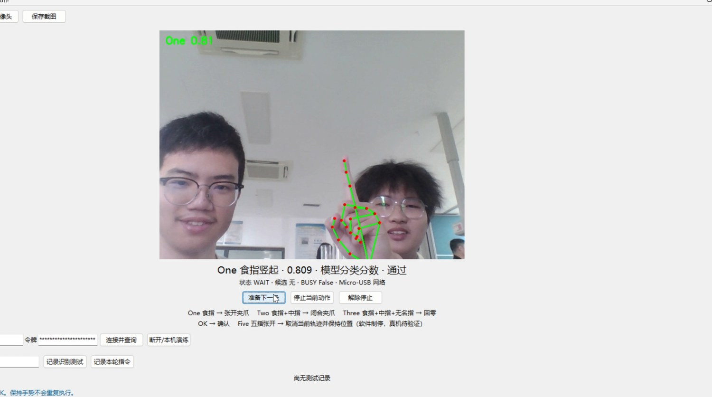
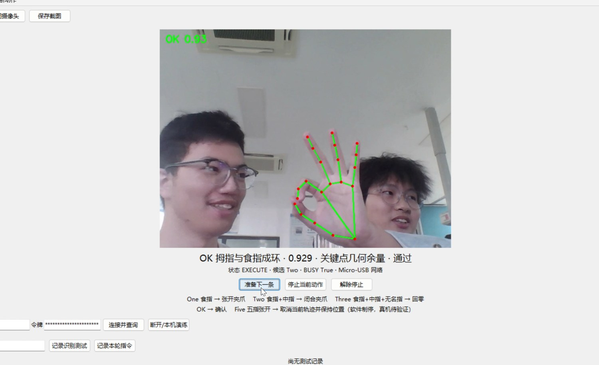
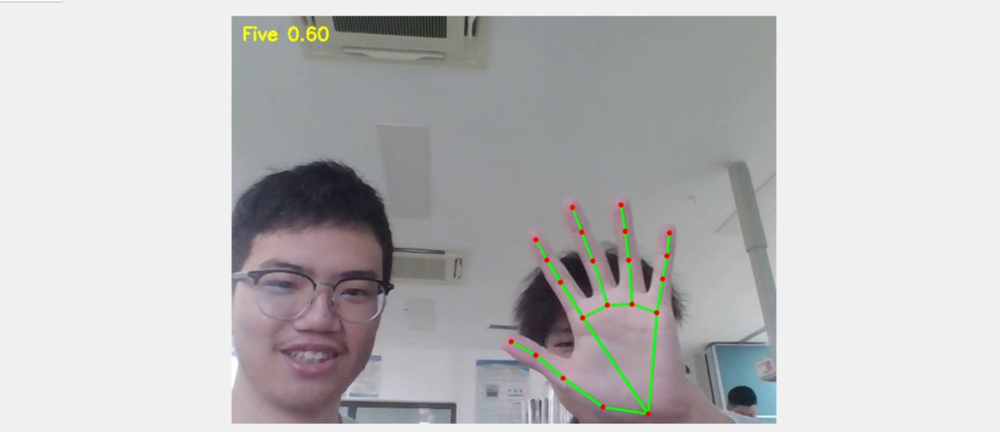
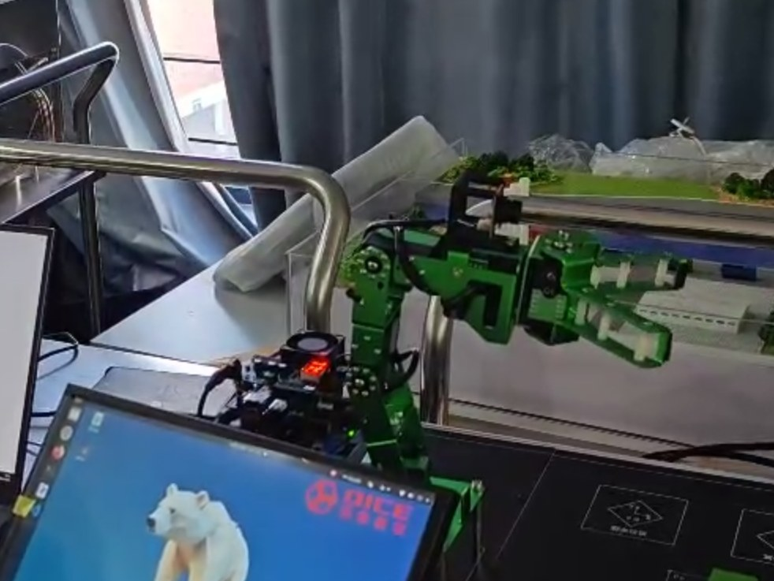

# 手势识别与交互搬运实验结果

## 1. 实验目的

整理五种手势、分数、连续帧确认、BUSY互锁、夹爪/回零及软件停止记录，核对当前指令接口能否支持课程要求的完整交互搬运。

## 2. 实验环境

报告记本机Windows11/Python3.11.9、摄像头/MediaPipe Tasks/Tkinter；Micro-USB gadget HTTP连接Jetson，Jetson通过课程SDK与内部UART控制舵机0～5。本机虚拟环境、确切库版本、SDK/config【待补充：依赖与硬件标定资料】。

### 新增手册依据

[平台手册核对与页码索引](../../%E5%8F%82%E8%80%83%E8%B5%84%E6%96%99/%E5%B9%B3%E5%8F%B0%E6%89%8B%E5%86%8C%E6%A0%B8%E5%AF%B9.md)补充平台原理与默认连接。厂商说明采用Jetson Nano/Ubuntu18.04，介绍JetPack4.4/L4T32.4.3；这不等于本组实验当天的完整环境快照。所有成功率、原始CSV与报告日期保持原口径。手册示例图片不新增为本组实测证据。

## 3. 实验过程

本机创建识别器并实时标注→解除停止/准备→One/Two/Three连续3帧选择→OK连续3帧确认→HTTP提交→单动作线程→回执后人工准备下一轮。Five连续2帧发送独立停止请求；接收端cancel后读取角度并保持。报告给出5种手势截图、夹爪开闭和回零前后图、10轮测试表及22条回执描述。

报告提到完整结果目录 `results/20261026_140922/`、录像 `VID_20261026_142404.mp4`、records/动作回执汇总.csv和verification/自动测试结果.txt，扫描普通文件、隐藏文件及ZIP均未发现。仅能以原报告为这些陈述的来源，不能声称已核对其原始日志。

## 4. 实验结果

| 测试编号 | 测试项目 | 测试条件 | 预期结果 | 实际结果 | 结论 |
|---|---|---|---|---|---|
| M4-01 | One/Two | 原报告识别截图 | 分数≥0.70 | One0.809、Two0.894 | 图像/报告支持识别 |
| M4-02 | Three/OK | 几何规则 | 分数≥0.70 | Three0.764、OK0.929/0.958 | 几何分数，不是概率 |
| M4-03 | Five低分 | 原报告图8 | 低于阈值不触发 | 0.60未通过 | 支持该帧被拒，不能证明停止成功 |
| M4-04 | 夹爪开闭/回零 | 报告前后帧 | 对应指令动作 | 报告记21条硬件、1条simulation完成回执 | 报告级证据；原始回执缺失 |
| M4-05 | 10轮手势 | 报告表4.4 | 符合约定动作 | 9轮触发+1轮低分不触发，误触发0 | 报告统计；部分手势由回执反推 |
| M4-06 | BUSY互锁 | UI截图/代码分支 | 不接受新动作 | 图6/7显示BUSY；报告记未重复发送 | 静态实现与定性截图；缺独立逐帧事件 |
| M4-07 | Five制停 | 报告图12及停止说明 | 中断并保持 | 报告记停在当前姿态，同时说明无interrupted回执 | 定性报告记录；时延/反馈闭环待补 |
| M4-08 | 完整物块搬运 | 当前主命令集 | 选择物块/目标、抓取投放 | 仅开爪、闭爪、home三个动作 | 未形成完整搬运实现/证据 |

## 5. 实验截图

图4-1：实验七报告word/media/image3.jpg，One模型分数0.809，WAIT状态。

图4-2：实验七报告word/media/image6.jpg，OK几何分数0.929，EXECUTE/BUSY True。

图4-3：实验七报告word/media/image8.jpg，Five=0.60低于门槛，不能用于证明Five成功制停。

图4-4：原报告录像抽帧后的嵌入图，只能按报告所述动作解释，原MP4缺失。全部五种手势、开闭夹爪、回零前后和报告停止图见[完整图片索引](figures/图片索引.md)。图片未重绘、不改变比例；实验5重复手势截图不再重复统计。

## 6. 实验数据

[报告10轮表转录](../../../homework/results/gesture_control/data/week7_%E6%8A%A5%E5%91%8A10%E8%BD%AE%E8%A1%A8%E8%BD%AC%E5%BD%95.csv)明确标注转录来源：9轮动作符合预期、1轮Five低分不触发；按报告口径正确触发9/10=90%，误触发0/10=0%。若把该低分拒绝也视为预期，则表中10/10符合设计预期。该表并非独立逐帧标注集，报告说明手势序列由动作回执反推，不能据此计算识别模型的真实准确率或随机总体误触发概率。

报告另称22条最终回执，其中hardware21、simulation1；硬件动作open_gripper8、close_gripper6、home7，相加为21。原始22条日志缺失，现不能逐条复算、对齐或确认模式。报告同时注明没有interrupted回执，不提供Five成功中断次数或毫秒级制停时间。

[app_stdout.log](records/app_stdout.log)仅有模型已找到提示；[app_stderr.log](records/app_stderr.log)保留MediaPipe/TFLite初始化与警告，不能证明实体执行成功。当前唯一events.jsonl实际上属于模块3旧分拣预检异常，共14条connect异常，不得移作手势成功日志。原有test_usb.py源码已归档，本次未执行；报告所称“10项全通过”的原测试结果文件待补。

## 7. 遇到的问题及解决过程

- Invalid token → 每次服务启动生成新TOKEN → 报告记复制当次TOKEN重连 → 报告记连接恢复；当前无网络抓包/回执可独立复核。
- Three/OK临界互扰 → 几何规则临界手形 → 现代码先OK再Three并做3帧确认 → 报告截图分数通过，缺带真值的混淆矩阵。
- 摄像头占用/取帧失败 → 报告分析设备占用或USB问题 → 释放旧程序、确认编号 → 报告记恢复，持续时长未附原始日志。
- 拔线触发制停 → 心跳超过1.5s → 接收端设计为cancel/hold，恢复后clear并重新准备 → 代码分支存在，真机角度时间序列与断线事件待补。

## 8. 实验结论

识别、状态机、网络收发和可中断执行器代码完整归档；报告提供基本夹爪与回零的图像及测试表。现有实现没有物块/目标选择及搬运任务API，不能写为完整手势搬运已完成。Five闭环反馈、BUSY重复输入测试与统计需要原始日志补证。

## 9. 原始材料索引

[原报告索引](original_reports/README.md)以实验七原报告为主，交叉引用实验5第5.4节。源脚本主副本为原week7/gesture_usb，其他两处相同脚本在文件映射表中引用；早期三本week7 Notebook保留在1.1_code/week7，不与USB新协议混用。缺失材料清单见项目根文档。

新增参考：[手册PDF第30页](../../../homework/docs/references/DICE_%E7%99%BD%E7%86%8A%E4%BA%BA%E5%B7%A5%E6%99%BA%E8%83%BD%E5%AE%9E%E8%AE%AD%E5%B9%B3%E5%8F%B0%E7%94%A8%E6%88%B7%E6%89%8B%E5%86%8C.pdf#page=30)；[平台手册核对与页码索引](../../%E5%8F%82%E8%80%83%E8%B5%84%E6%96%99/%E5%B9%B3%E5%8F%B0%E6%89%8B%E5%86%8C%E6%A0%B8%E5%AF%B9.md)。
