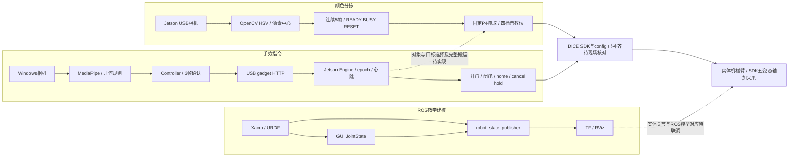

# Robot — 机器人感知与控制综合实践

## 1. 项目简介

第11组机器人实践资料归档。以当前工作区真实源码、week1/3/4/5/6/7报告、图片、视频与CSV为基础，整理四个模块。未发现独立week2，第二章资料位于arm2026_ws。原始材料保留；新增三个SDK/视觉目录保留在工作区根目录，robot_ws通过链接说明。

新增资料：[平台手册核对与页码索引](%E5%8F%82%E8%80%83%E8%B5%84%E6%96%99/%E5%B9%B3%E5%8F%B0%E6%89%8B%E5%86%8C%E6%A0%B8%E5%AF%B9.md)，已按手册补充平台组成、串口/API单位、关节标定与Arm5DoF运动学；保留手册参考环境与实际实验记录的区别。

新增代码：[SDK与标定资料核对](参考资料/新增SDK核对.md)。真机控制库、仿真库和视觉标定代码已经补齐；最终实验结论以原报告与现场确认结果为准，姿态无逆解已通过角度取模和可行边界修正解决；旧副本离线核对作为版本差异记录。

独立提交成果见[课程项目报告](../第11组_机械臂颜色分拣与手势交互控制_课程项目报告.docx)和[配套提交包](../第11组_课程项目提交包/README.md)。报告已经按技术逻辑整合，实验报告的数据、参数和效果优先；以下归档说明保留原文件路径便于追溯。

## 2. 项目目标

建立课程报告、代码展示与验收的统一入口，使函数、参数、实验结论和原始来源相互对应。区分“静态存在的实现”“报告记载完成”“原始记录可核对”与“尚待验证”，不把原型、演练或第三方参考当成已完成实体功能。

课程任务书基础分为25/15/15/25，共80分，拓展20分；以下状态是材料核对结果，不代替教师评分。

## 3. 系统总体架构



三条链路分别已有实现/记录，尚无统一ROS图像订阅与整套launch。教学模型6个转动关节与当前SDK五姿态轴加夹爪尚未完成统一映射；手册概述称六自由度且混有Arm_Lib案例，不能只凭名称判定对应关系；两个实体控制入口为独立实验程序，归档没有将其拼成同时运行的系统。

## 4. 功能模块

### 4.1 机器人建模与实验平台搭建

[技术说明](01_robot_modeling_and_platform_setup/1.2_readme/README.md) · [实验结果](01_robot_modeling_and_platform_setup/1.3_experiment_results/%E5%AE%9E%E9%AA%8C%E7%BB%93%E6%9E%9C.md) · [原始报告](01_robot_modeling_and_platform_setup/1.3_experiment_results/original_reports/README.md)

代码：完整marm_description包、5份Xacro、4份launch、2份RViz配置及离线预览脚本。报告：第一周、第二章答辩版/模板。状态：几何和关节链有代码及历史验证，统一相机启动/实物映射未完成。

### 4.2 机械臂运动控制

[技术说明](02_robot_arm_motion_control/1.2_readme/README.md) · [实验结果](02_robot_arm_motion_control/1.3_experiment_results/%E5%AE%9E%E9%AA%8C%E7%BB%93%E6%9E%9C.md) · [原始报告](02_robot_arm_motion_control/1.3_experiment_results/original_reports/README.md)

代码：week3归位、week4分块堆叠Notebook。报告：week1交叉引用、week3/4。状态：有动作与成功率记录，SDK/config已补齐，姿态修正及成功率按实验报告采用，文件版本差异另表保留。

### 4.3 视觉目标识别与自动分拣

[技术说明](03_visual_target_recognition_and_sorting/1.2_readme/README.md) · [实验结果](03_visual_target_recognition_and_sorting/1.3_experiment_results/%E5%AE%9E%E9%AA%8C%E7%BB%93%E6%9E%9C.md) · [原始报告](03_visual_target_recognition_and_sorting/1.3_experiment_results/original_reports/README.md)

代码：week5主Notebook/CLI/多面投票、week6固定P4主版本及6份独立历史Notebook。报告：week5终稿、week6。状态：识别及固定P4分拣有证据；任意位置标定抓取未核实。

### 4.4 手势识别与交互搬运

[技术说明](04_gesture_recognition_and_interactive_manipulation/1.2_readme/README.md) · [实验结果](04_gesture_recognition_and_interactive_manipulation/1.3_experiment_results/%E5%AE%9E%E9%AA%8C%E7%BB%93%E6%9E%9C.md) · [原始报告](04_gesture_recognition_and_interactive_manipulation/1.3_experiment_results/original_reports/README.md)

代码：gesture_usb全套脚本、两条必要模型路径和4本旧/识别Notebook。报告：实验七，交叉引用实验5第5.4节。状态：基本指令接口和报告图像完整归档，原始回执/录像缺失，完整搬运待实现。


## 5. 项目目录

```text
robot_ws/
├── README.md
├── 文件映射表.md
├── 待补充材料清单.md
├── 目录树.txt
├── 课程要求与模板/          原任务书、报告模板、Ch6/7/8任务PDF
├── 整理记录/                全文件清单、SHA-256、版本、来源与静态检查
├── 参考资料/                新增DICE手册与逐页核对说明
├── 01_robot_modeling_and_platform_setup/
├── 02_robot_arm_motion_control/
├── 03_visual_target_recognition_and_sorting/
└── 04_gesture_recognition_and_interactive_manipulation/
    # 四个模块均为相同三部分：
    ├── 1.1_code/             源码和必要配置，保留内部结构
    ├── 1.2_readme/README.md
    └── 1.3_experiment_results/
        ├── 实验结果.md
        ├── figures/          图片与逐图来源索引
        ├── records/          原始CSV/日志、明确标注的报告转录
        └── original_reports/ 原报告副本与跨模块索引
```

完整实际文件树见[目录树](目录树.txt)，逐文件处理见[文件映射表](文件映射表.md)；原始1448个文件全部登记（首轮1447个及本次新增手册1个），三个ZIP另有337个非目录成员记录。构建缓存、Office锁文件、检查点和第三方参考保留原处。

随后补入的三个SDK/视觉目录共有234个文件，单独登记在[新增SDK文件清单](整理记录/新增SDK文件清单.csv)；原1448项历史基线保留，不用新增材料覆盖旧记录。

## 6. 开发环境

| 链路 | 已有环境证据 | 缺口 |
|---|---|---|
| ROS建模 | WSL2 Ubuntu20.04 / ROS1 Noetic / WSLg | 完整版本、导出catkin入口恢复、可见RViz图 |
| 点位/分拣 | Jetson/Linux/Jupyter，Notebook多记Python3.8.10；相机示例输出OpenCV4.5.1 | SDK/config已补；JetPack与库清单、配置有效性待核实 |
| 本机手势 | 报告Windows11/Python3.11.9，MediaPipe Tasks/OpenCV/NumPy/Pillow/Tkinter | `.venv-gesture`及精确版本 |
| Jetson接收 | receiver_usb声明Python3.6+兼容，HTTP标准库 | SDK已补；串口依赖、标定与现场版本待核实 |

Notebook元数据不是所有实验运行环境的统一证明。模型文件随模块4归档；新增arm5dof_python_uservo已包含DICE控制库、config与transform/pose；arm5dof_visual_grasping包含camera/image2workspace和vconfig。Unitree参考SDK不用于替代实体DICE SDK。

厂商手册补充：平台主控系列为Jetson Nano，参考组成含随臂USB摄像头、机械臂载板、听觉/传感器模块、屏幕和键鼠；手册参考系统Ubuntu18.04，介绍JetPack4.4/L4T32.4.3。当前ROS建模WSL20.04/Noetic、实验Notebook元数据和本机MediaPipe环境分别保留，不把手册版本强制写为实测版本。

Jetson的Jupyter默认地址为`http://192.168.55.1:8888`，项目自建手势接收服务为`:8765`；内部舵机UART手册默认`/dev/ttyTHS1`、115200/8N1。具体页码与SDK资料来源线索见[平台手册核对与页码索引](%E5%8F%82%E8%80%83%E8%B5%84%E6%96%99/%E5%B9%B3%E5%8F%B0%E6%89%8B%E5%86%8C%E6%A0%B8%E5%AF%B9.md)。

## 7. 系统运行流程

1. 查看[代码版本说明](整理记录/代码版本说明.md)，按报告对应入口选择程序。
2. 在原Linux/Jetson/Windows环境的运行副本恢复依赖；模块README给出命令及待验证状态。
3. 分别检查ROS建模、独立识别、点位控制、固定P4分拣、USB手势控制，保留各自日志，不能混接旧Notebook协议与新USB脚本。
4. 归档验收可使用[静态检查工具](整理记录/静态验证.py)，只读AST/XML/链接/哈希，不导入控制程序。本次SDK核对仅执行纯运动学计算，未启动相机/网络服务、ROS或机械臂，未执行动作Cell；不把离线计算当作真机结果。

## 8. 实验结果汇总

| 项目 | 现有结果 | 数据口径与边界 |
|---|---|---|
| 模型结构 | 主模型11links/10joints/68visual/9collision | XML及既有解析记录；标准inertial缺失，RViz截图待补 |
| 四块归位 | 11/12=91.67% | week3报告三轮表，当前代码/报告顺序不同 |
| 四层堆叠 | 10/12=83.33% | week4报告三轮表，按块次，分Cell执行 |
| HSV单块识别 | 22/28=78.57% | 原CSV唯一目标且同色；28条均包含真值色并不等于全部正确 |
| 分拣最终验收 | 人工8/8=100% | 两轮固定红黄绿蓝，未与44条调试日志对齐 |
| 分拣调试 | 35清空待确认、8失败、1夹取未成功 | 44条原CSV；P4清空不等于正确入桶 |
| 手势指令 | 报告9轮触发、1轮正确不触发、0误触发 | 原报告10轮转录，非独立逐帧真值；22条回执原始文件缺失 |
| 完整手势搬运 | 当前无完整任务链 | 仅开爪/闭爪/home；Ch8物块/目标选择与抓放验收待完成 |

第一周两张标定姿态图已核实与手册图5.7.1/5.7.2同源，现标作标准姿态示意，不计为本组实拍；报告反馈数值与原CSV没有改动。

## 9. 项目实现状态

项目归档与文档已完成，原实验的验收缺口见[待补充材料清单](待补充材料清单.md)。优先事项是核对新增SDK/config与现场版本、保留姿态修正记录、核实源代码与报告版本、补齐手势原始回执与录像、完善ROS相机启动和完整搬运任务。

课程报告章节对应：模块1→机器人建模与实验平台设计；模块2/3/4→算法原理、设计与实现效果；四模块实验结果→综合实验结果与问题分析。原课程报告空白模板保留；第11组报告已有初稿与本次另存的SDK核对修订稿。

任务书要求标注AI辅助范围。本次范围为文件扫描分类、源码/报告分析、Markdown说明与静态校验；未新增控制算法、未修改参数、未生成实验图或测试数据。报告正式提交前，应由组员核对归档结论、注明各自开发与人工复核部分。

## 10. 常见问题

- 为何不能双击就复现：SDK/config现已补齐，但Notebook的SDK搜索路径、视觉vconfig路径及虚拟环境仍需匹配；ROS顶层CMake链接导出为路径文本。详见各模块依赖与运行步骤。
- 为何同时保留多个版本：HSV评分、分拣帧数、映射路线及手势协议不同，合并会改变实验解释。主副本与历史关系已写入版本表。
- 为何手势22条不直接算搬运成功：当前动作集只包含开闭夹爪与回零，且原始22条回执缺失。报告图像和文字按其证据范围保留。
- 为何不复制build/devel与外部网格：它们是原环境产物和未被主工程加载的参考资源，原处完整保留并逐文件映射；新工程保存实际描述包及必要配置。

## 11. 参考资料

原任务书、课程报告模板及Ch5～Ch8课程要求；各模块原始实验报告；ROS/URDF/Xacro、OpenCV和MediaPipe官方文档链接见模块README。原建模说明列出的Unitree参考仓库是外观/结构参考，未作为实物控制实现。


新增厂商来源：[DICE白熊人工智能实训平台用户手册](%E5%8F%82%E8%80%83%E8%B5%84%E6%96%99/DICE_%E7%99%BD%E7%86%8A%E4%BA%BA%E5%B7%A5%E6%99%BA%E8%83%BD%E5%AE%9E%E8%AE%AD%E5%B9%B3%E5%8F%B0%E7%94%A8%E6%88%B7%E6%89%8B%E5%86%8C.pdf#page=1)，重点章节1.2、2.1/2.3、5.4～5.8、6.2、7.13、9.5；[平台手册核对与页码索引](%E5%8F%82%E8%80%83%E8%B5%84%E6%96%99/%E5%B9%B3%E5%8F%B0%E6%89%8B%E5%86%8C%E6%A0%B8%E5%AF%B9.md)。
