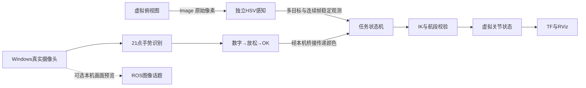

# 机械臂目标识别与手势搬运综合实践

本项目在已有六轴机械臂模型上，完成 ROS 图像话题驱动的 HSV 识别、虚拟自动分拣、关节示教、末端点到点运动及数字手势确认搬运。课程代码 S0610350。这里记录可复现的软件结果与仍需本人完成的验收工作，不代替个人实验记录和综合设计报告。

## 任务书对照与当前边界

| 任务要求 | 当前实现与证据 | 尚需完成 |
| --- | --- | --- |
| URDF、编译与 RViz | 保留原模型；catkin 编译、URDF 解析通过；启动模型与 TF | 本人讲解关键标签、关节坐标系 |
| 关节、夹爪、点到点、航点 | 新增关节与末端目标话题；原抓放八航段；运行回归通过 | 实体平台接口、限位和夹持实测 |
| 图像话题与 HSV 分拣 | 原始图像→独立感知节点→稳定观测→虚拟搬运；支持读取、显示、保存虚拟图像 | 真实桌面图像、相机标定、真实物体抓取 |
| 手势状态机 | 真实 Windows 摄像头识别；1～4选择，放松后OK确认；桥接防重复 | 本人完成不同手势和光照条件下的统计实验 |
| 优化视觉识别 | 形态学、形状筛选、多目标检测、同色歧义拒绝、连续帧稳定；有旧算法对照 | 在真实桌面采集独立测试集，验证阈值泛化 |
| 一键加载 | course_project.launch 启动模型、感知、搬运、RViz、桥接；可同时启动现有 Windows 摄像头程序 | 在队友电脑按其环境路径复现 |
| 交付与规范 | 新版源码包只放一个 README，保留必要第三方许可 | 综合设计报告、≤3分钟新演示、真实分工、参考文献与AI使用说明 |

任务书以实体机械臂为主。当前执行器仍是 RViz 运动学模型，虚拟附着不等于物理夹持，没有接触动力学、完整避障、MoveIt 或实物驱动。真实摄像头目前用于手势，桌面方块来自明确标记的虚拟俯视图；二者不混用标定。项目仓库为https://github.com/Frankie417/ros_work，任务书要求小组3人，成员独立模块见综合报告分工。

## 环境与一键启动

WSL Ubuntu 20.04、ROS1 Noetic、Python3；WSL 需要 NumPy、OpenCV、PyYAML。Windows 端沿用已有 Python3.12 环境与 gesture_pc/requirements.txt，不修改系统 Python。每次只运行一套发布 /joint_states 的模型程序。

```bash
source /opt/ros/noetic/setup.bash
cd /home/cubertzk/arm2026_ws
catkin_make && source devel/setup.bash
roslaunch marm_color_pick course_project.launch windows_camera:=true
```

上述命令使用本机现有 Windows 环境 `/mnt/d/robot_new/.venv-arm2026-gesture/Scripts/python.exe`。其他电脑需传入 `windows_python:=/mnt/实际路径/Scripts/python.exe`。WSL 和 Windows 互操作必须可用；摄像头不能被其他程序占用。无需另开终端执行 roscore。

若本机初次连接ROS master持续等待，按Ctrl+C停止该次启动，保持已刷新环境后执行 `python3 scripts/start_course.py windows_camera:=true`，限制初始网络连接等待；不要同时运行两个启动入口。

其他电脑首次配置 Windows 环境时，可在 PowerShell 执行，路径按本机实际发行版和用户名填写：

```powershell
$root = '\\wsl.localhost\Ubuntu-20.04\home\实际用户名\arm2026_ws'
$envDir = "$env:USERPROFILE\arm2026-gesture-env"
py -3.12 -m venv $envDir
& "$envDir\Scripts\python.exe" -m pip install -r "$root\src\marm_color_pick\gesture_pc\requirements.txt"
```

随后在WSL启动命令中将 windows_python 设为该环境 Scripts/python.exe 对应的 `/mnt/c/Users/用户名/...` 路径。当前电脑已有环境，不需要重复创建或安装。

无摄像头时可先验证自动分拣：

```bash
roslaunch marm_color_pick course_project.launch gesture:=false auto_start:=true
```

仅启动 WSL 部分、手工启动已有摄像头界面时：

```bash
roslaunch marm_color_pick course_project.launch
```

然后运行 Windows 端 gesture_pc/start_gesture.bat；若要将原始摄像头画面同时发布到 ROS，以 Windows Python 执行 app.py 时加 `--publish-images`。该选项只传输到经令牌验证的本机回环桥接，不保存摄像头画面，不上传云端。预览时间戳为桥接接收时刻，不能用于精密视觉同步。

点击摄像头窗口按 S 启用，先放松半秒；做数字约1秒，放松半秒，再做OK约1秒。1红、2黄、3蓝、4绿。空格暂停后续手势输入；R仅复位空闲虚拟场景；Esc退出摄像头。暂停或退出不取消已经接受的动作。每轮每种颜色只执行一次。

RViz 默认显示独立 HSV 图像；需要时勾选 Real webcam 显示真实手部画面。不要把摄像头对着人的画面描述为桌面物块定位。

## 软件结构与消息链路



| 文件 | 作用 |
| --- | --- |
| src/marm_description/urdf/marm_modular_core.xacro | 连杆、关节、外观、碰撞与惯性描述；本次未改动 |
| src/marm_color_pick/launch/course_project.launch | 综合启动入口，包含原 color_pick.launch |
| src/marm_color_pick/scripts/color_pick_node.py | 唯一关节发布者、抓放状态机、手动关节/末端目标接口 |
| src/marm_color_pick/scripts/pick_core.py | 真实URDF正运动学、专用平面逆解、虚拟成像；原有实现保留 |
| src/marm_color_pick/scripts/perception_core.py | HSV多目标、形态学、形状/源区筛选、连续帧判定 |
| src/marm_color_pick/scripts/perception_node.py | 独立订阅 Image 并发布带时间戳的识别结果 |
| src/marm_color_pick/scripts/gesture_bridge.py | 本机鉴权、会话校验、去重、防忙碌与预览通道 |
| src/marm_color_pick/scripts/windows_camera.py | 从WSL启动现有Windows摄像头程序并管理本次子进程 |
| src/marm_color_pick/gesture_pc/recognizer.py、gesture_gate.py | 手部点位规则与确认状态机 |
| src/marm_color_pick/gesture_pc/frame_sender.py | 后台发送最新画面，避免网络操作阻塞手势取帧 |
| src/marm_color_pick/config/scene.yaml | 场景尺寸、目标区域、抬升高度、动作时间与虚拟映射范围 |

图像接口 `/color_pick/image_raw` 类型为 sensor_msgs/Image，720×600、bgr8、step=2160。感知节点检查长度、行跨度、通道顺序、图像时间戳及来源标识；固定映射只适用于虚拟正交图像。真实摄像头预览 `/gesture/camera/image_raw` 为640×480，使用独立来源标识，不接入虚拟方块逆映射。

`/color_pick/observations` 是 std_msgs/String 封装的 JSON，含 stamp、calibration、objects、stable、ambiguous、processing_ms。objects可包含同色多目标；仅源区域恰有一个该色目标、连续3帧位移≤8mm时，才进入stable。丢失或出现同色歧义时立即失效；超过0.5秒的观测不用于启动抓取。正在执行的航段使用开始时确认的位置，不宣称视觉伺服跟踪。

`/joint_states` 包含六轴和夹爪7个关节；`/color_pick/status` 提供动作状态、队列、完成颜色、事件与错误。真实关节坐标与父子关系来自原 URDF。运动采用三次平滑插值，笛卡尔航段检查可达性、限位并参考URDF速度值延长时长；这是有限采样检查，不等于完整连续碰撞证明。

## 现场演示关节、夹爪和末端点到点

先暂停摄像头输入，确保状态空闲。以下命令在另一个已经 source 的终端执行；不要并行执行多个演示命令。

```bash
# 单关节：单位弧度，运动结束后再做下一项
rostopic pub -1 /color_pick/joint_target sensor_msgs/JointState "{name: ['marm_mod_joint1'], position: [0.20]}"
# 多关节协同
rostopic pub -1 /color_pick/joint_target sensor_msgs/JointState "{name: ['marm_mod_joint1','marm_mod_joint6'], position: [0.0,-1.47]}"
# 夹爪闭合与张开，分别执行并等待完成
rostopic pub -1 /color_pick/joint_target sensor_msgs/JointState "{name: ['marm_mod_gripper_joint'], position: [0.0]}"
rostopic pub -1 /color_pick/joint_target sensor_msgs/JointState "{name: ['marm_mod_gripper_joint'], position: [-0.95]}"
# 恢复向下抓取的初始姿态，完成后再发送末端目标
rosservice call /color_pick/reset "{}"
rostopic pub -1 /color_pick/target geometry_msgs/PointStamped "{header: {frame_id: 'marm_mod_base_link'}, point: {x: 0.24, y: 0.02, z: 0.15}}"
```

PointStamped中的点为方块中心参考点，不是grasping_frame原点。专用逆解约束夹爪朝下，不能表示任意六维末端姿态。任意关节示教后应先复位再执行笛卡尔演示。关节示教未执行全臂碰撞检测，只用于虚拟验收；不接实物。

自动抓放由接近、下降、闭合、抬起、搬运、下降、松开、撤离八阶段构成。放置完成发生在松爪阶段，后续撤离是另一阶段，报告截图应依画面中的物块位置说明。

## 验证与数据留存

```bash
# 离线测试
mkdir -p generated/task2_local
xacro src/marm_description/urdf/marm_modular.xacro -o /tmp/marm_task2.urdf
check_urdf /tmp/marm_task2.urdf
python3 src/marm_color_pick/scripts/test_color_pick.py --urdf /tmp/marm_task2.urdf --config src/marm_color_pick/config/scene.yaml
python3 src/marm_color_pick/scripts/benchmark_perception.py --config src/marm_color_pick/config/scene.yaml --output generated/task2_local/perception.json
python3 src/marm_color_pick/gesture_pc/test_gesture_gate.py
# 场景运行时：只读话题检查，可选保存虚拟图像；不保存真实摄像头
python3 src/marm_color_pick/scripts/check_course_system.py --output generated/task2_local/topics.json --save-virtual-image generated/task2_local/virtual.png
# 摄像头正在运行时，可在上条命令加 --require-webcam
# 下两条会改变虚拟场景，须先暂停手势输入，等待空闲后依次执行
python3 src/marm_color_pick/scripts/test_motion_runtime.py --output generated/task2_local/motion.json
python3 src/marm_color_pick/scripts/validate_runtime.py --output generated/task2_local/grasp.json
```

本次原始结果存于工作区 generated/task2_20261113，源码包不夹带旧报告素材。2026-11-13已完成：catkin与check_urdf、2424个运动学采样点、单/多关节与夹爪/末端接口、完整四色分拣、Windows摄像头取帧与ROS图像通路。摄像头短时测试没有检测到手，不能作为新一轮真实手势准确率结果。

合成鲁棒性实验使用固定随机种子20261113，正常、27%亮度、高斯噪声、随机小孔、模糊各12张，每张4个目标；定位误差＜2mm记为命中。旧算法192/240，新算法240/240，提升来自低亮度组；其余条件两者均48/48。所有稳定帧重复同一张图，只用于验证门控逻辑，不是动态场景统计独立样本。指标只适用于该合成集，不能等同真实识别率或实物抓取精度。

还应由本人采集真实光照、背景、距离变化样本，记录每类手势的尝试数/成功数、误触发数、完整搬运耗时与失败原因；不应把软件FK残差描述成实物定位精度。建议选“视觉鲁棒性改进及对照验证”作为主要加分项，先补真实实验，再考虑MoveIt等额外复杂模块。

## 已遇问题与处理

| 问题 | 原因与处理 |
| --- | --- |
| xacro提示找不到marm_description | 构建后尚未刷新工作空间；source devel/setup.bash后通过 |
| 测试时重复启动master | roscore和roslaunch竞争自动启动；只保留一条综合launch入口 |
| 复位后马上发运动命令被拒绝 | Trigger接受复位不代表主循环已完成复位；等待新的空闲状态回报后再发 |
| 低亮度虚拟图像漏检 | 原V下限80；独立算法降为35并加入形态学和几何/连续帧约束，通过对照验证 |
| 同色出现多个目标 | 不随意抓最大的一个；保留全部检测，源区同色数量不为1时不派发 |
| 图像断流、旧时间戳或错误来源 | 拒绝该帧，稳定检测自动失效；待有效目标恢复后再开始任务 |

## 综合报告、分工与验收准备

保留第二章原报告与原格式，另按任务书准备综合设计报告。建议按“需求—总体架构—URDF平台—运动控制—HSV—手势状态机—实测结果—排错与改进—分工—参考文献”的顺序，由成员用自己的实验记录写作。原报告不能直接改标题就当作已满足全部综合任务。

分工需本人据实填写，不能由工具虚构。至少明确模型/运动模块与感知/状态机模块各自负责者，以及各自独立完成的文件、修改、调试记录；每人能回答其模块输入输出、参数含义和失败处理。最终人数以任务书及教师认可为准。

新视频不超过3分钟，可分配：20秒系统与坐标系、30秒关节/夹爪/点到点、30秒HSV与对照、70秒手势确认搬运、20秒误触保护和结果、10秒分工与限制。最终口述、录制和实际手势必须由成员完成，不用生成图替代实验画面。

工程体会可结合实际取舍说明：轻量HSV比训练新模型更容易解释和部署；改阈值必须同时控制误检；通信失败和忙碌状态应拒绝新任务；来源、失败和AI辅助范围应可追溯。请结合本组亲历事实，不照抄泛泛表述。

## 参考来源与AI辅助范围

1. ROS官方 sensor_msgs/Image 消息定义：https://github.com/ros/common_msgs/blob/noetic-devel/sensor_msgs/msg/Image.msg
2. ROS官方 sensor_msgs/JointState 消息定义：https://github.com/ros/common_msgs/blob/noetic-devel/sensor_msgs/msg/JointState.msg
3. OpenCV官方HSV阈值教程：https://docs.opencv.org/4.x/da/d97/tutorial_threshold_inRange.html
4. MediaPipe手势识别模型：https://github.com/google-ai-edge/mediapipe ；模型包来源和许可见 third_party/NOTICE（源码包内）。该模型非本组训练。
5. 既有机械外观参考来源：https://github.com/unitreerobotics/z1_ros 。本项目为组合几何体模型，未复制其STL/DAE；参考不能因为更名而省略。

已有项目仓库：https://github.com/Frankie417/robot （私有，未申请改为公开，本次也未推送）。若后续由仓库所有者公开分享，应在综合报告和公开README填写实际课程班别代码，例如 `(2026-2027-1)-S0610350-01`，其中末尾班别必须核实，不自行猜填。

本次使用AI辅助任务要求梳理、增量代码修改、自动化测试与此技术说明；既有流程示意图含AI辅助绘制内容。所列数值来自实际运行的测试程序，合成扰动图像明确标注为合成测试输入。没有新生成实物实验数据或冒充真实运行截图。提交前成员必须阅读、理解、人工修改与调试相关模块，并在自己的报告写清具体AI使用范围、人工完善过程及本人实测证据；本说明不代表这些人工环节已完成。
